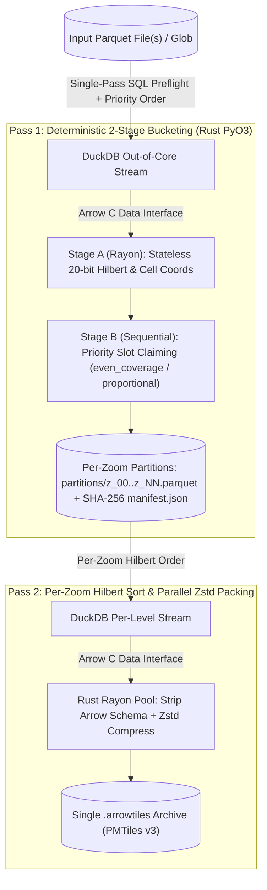

# ArrowTiles (`arrowtiles`)

[](LICENSE)
[](https://duckdb.org)
[](https://www.rust-lang.org/)
[](https://www.python.org/)

**ArrowTiles** (`pip install arrowtiles`) is a deterministic DuckDB + Rust (`PyO3`) spatial pyramid builder, reference reader, and validator that packs multi-million to billion-row Parquet datasets (such as the **1.8 billion row ESA Gaia DR3 catalogue** or **2.84 million LMSys UMAP embeddings**) into single-file, HTTP Range-streamable **`.arrowtiles` (`v0.1`)** archives.

- **Wire-Format Specification:** [`docs/SPEC.md`](docs/SPEC.md)
- **Range & Decode Benchmarks vs. Parquet:** [`docs/BENCHMARK_parquet_vs_arrowtiles.md`](docs/BENCHMARK_parquet_vs_arrowtiles.md)
- **Companion WebGPU Viewer Engine:** **[deepgraph](https://github.com/kai-erlenbusch/deepgraph)** (`npm install deepgraph`)

---

## Why `.arrowtiles`? ("PMTiles for Point Clouds & Embeddings")

Traditional multiscale scatterplots write hundreds of thousands of tiny `.feather` or `.bin` files (exhausting S3 PUT budgets and browser HTTP connection pools), while raw remote Parquet files require fetching wide multi-megabyte row groups for coarse overviews.

`.arrowtiles` packs a multiscale priority quadtree of Zstd-compressed, schema-stripped **Apache Arrow IPC `RecordBatch`es** inside a standard **PMTiles v3** single-file container:
- **Single-file CDN/S3 deployment:** Zero server logic—any static bucket or HTTP Range server streams tiles directly to WebGPU workers.
- **Byte-for-byte deterministic builds:** Rebuilding the same Parquet input produces an identical SHA-256 `.arrowtiles` archive across runs and `--resume` checkpoints.
- **Zero-copy GPU column alignment:** Coordinates quantize to `x_u16` / `y_u16` per tile while categorical dictionaries (`UInt8`/`UInt16`) and global column `min`/`max` statistics live in the single PMTiles JSON header.

---

## Architecture: Deterministic 2-Pass Pipeline



1. **Single-Pass SQL Preflight (`arrowtiles/builder.py`):** DuckDB computes global bounds, row counts, `id_col` uniqueness, numeric `min`/`max` stats, and categorical dictionaries in one scan—automatically omitting unrequested Pandas index columns (`__index_level_<N>__`) and high-cardinality free-text columns (`distinct > 4,096`), and downcasting finite in-range `Float64` (`DOUBLE`) payload columns to `Float32` unless `--keep-float64` is passed.
2. **Pass 1 — Zero-Atomic 2-Stage Bucketer (`arrowtiles-engine/src/lib.rs`):** DuckDB streams rows ordered by `(priority_key, row_id ASC)`—either an explicit `sort_col` (e.g. `phot_g_mean_mag ASC`) or portable `SplitMix64(row_id, seed)`—into Rust via the Arrow C Data Interface. Stage A computes `fast_hilbert` coordinates across all CPU cores; Stage B assigns zoom levels deterministically without atomic contention and writes per-zoom Parquet partitions (`z_00.parquet .. z_NN.parquet`) plus a cryptographic `manifest.json` (`--resume`).
3. **Pass 2 — Per-Zoom Packing:** Each zoom partition is sorted in memory by `(tile_id, hilbert_20, priority_ord)`, stripped of redundant per-tile Arrow IPC schema headers (stored once as base64 `arrow_schema` in metadata), Zstd-compressed in parallel via Rayon, and written into a PMTiles v3 archive.

---

## Installation & Source Build

```bash
pip install arrowtiles
```

### Building from Source (Python 3.10+ & Rust 1.80+)

```bash
git clone https://github.com/kai-erlenbusch/arrowtiles.git
cd arrowtiles

python -m venv .venv
# Windows: .venv\Scripts\activate   |   Linux/macOS: source .venv/bin/activate

pip install "maturin>=1.4,<2.0"
pip install -e ".[dev]" --no-build-isolation
maturin develop --release

# Run the test suite (53 tests):
pytest -v
```

---

## CLI Usage (`arrowtiles` / `python -m arrowtiles`)

```bash
# 1. Generic 2D embedding / point cloud (select active visual columns for fast overview streaming):
arrowtiles build \
  --input "embeddings.parquet" \
  --output "embeddings.arrowtiles" \
  --x-col x_umap --y-col y_umap \
  --columns model clusters_14 num_of_tokens \
  --categorical-cols clusters_14

# 2. ESA Gaia DR3 Hammer sky preset (phot_g_mean_mag ASC + even_coverage, 100k tile capacity):
arrowtiles build \
  --preset gaia \
  --input "gaia_batches/*.parquet" \
  --output "gaia.arrowtiles"

# 3. Validate an .arrowtiles archive against SPEC.md v0.1 (human report or --json):
arrowtiles validate "embeddings.arrowtiles"

# 4. Inspect PMTiles header, Arrow schema, and JSON metadata:
arrowtiles inspect "embeddings.arrowtiles"
```

> **Wide Tables & `--columns`:** Each `.arrowtiles` `v0.1` tile packs all retained columns into one Arrow IPC `RecordBatch` so browsers fetch an entire tile in **1 HTTP Range request**. On wide 30+-column tables, pass **`--columns <col1> <col2> ...`** (space- or comma-separated) to retain only the columns needed for visual encoding and keep `Z=0..2` overview bytes below `10 MiB`.

### Key `arrowtiles build` Options

| Argument | Description |
| :--- | :--- |
| `--input` | *(Required)* Path or glob pattern to input Parquet file(s). |
| `--output` | *(Required)* Output `.arrowtiles` archive path. |
| `--x-col`, `--y-col` | Source coordinate columns (required for generic builds). |
| `--columns` | Space- or comma-separated subset of payload columns to retain in tiles. |
| `--categorical-cols` | Space- or comma-separated columns (including integer cluster IDs) to dictionary-encode as `UInt8`/`UInt16`. |
| `--preset gaia` | Astronomical Galactic Hammer projection (`phot_g_mean_mag ASC`, `even_coverage`, `100,000` tile capacity). |
| `--sampling` | `proportional` (generic default, `25,000` capacity) or `even_coverage` (`G×G` sub-grid occupancy at `Z <= 6`). |
| `--tile-capacity` | Max rows per non-leaf tile (`25,000` generic default; `100,000` on `--preset gaia`). |
| `--max-zoom` | Nominal maximum quadtree zoom level before overflow spilling (default: `14`). |
| `--sort-col`, `--sort-dir` | Explicit priority column (`ASC` or `DESC`); defaults to deterministic `SplitMix64(row_id, seed)`. |
| `--seed` | Random seed for default `SplitMix64` priority ordering (default: `42`). |
| `--id-col` | Optional unique unsigned integer row ID column (defaults to dense `0 .. N-1` Parquet offset). |
| `--keep-source-xy` | Retain raw `Float32`/`Float64` source X/Y columns alongside quantized `x_u16`/`y_u16`. |
| `--keep-float64` | Retain `Float64` (`DOUBLE`) payload columns instead of downcasting in-range floats to `Float32`. |
| `--temp-dir`, `--resume` | Persist Pass 1 zoom partitions in `--temp-dir` and reuse verified SHA-256 `manifest.json` on `--resume`. |

---

## Python API Reference

```python
from arrowtiles import ArrowTilesReader, build_gaia, build_generic, validate_file

# 1. Build a v0.1 archive from Parquet:
summary = build_generic(
    input_parquet="embeddings.parquet",
    output_path="embeddings.arrowtiles",
    x_col="x_umap",
    y_col="y_umap",
    columns=["model", "num_of_tokens"],
    sampling="proportional",
)

# 2. Validate SPEC.md v0.1 invariants:
report = validate_file("embeddings.arrowtiles")
assert report.ok, report.errors

# 3. Inspect metadata and read decoded pyarrow.Table tiles:
with ArrowTilesReader("embeddings.arrowtiles") as reader:
    header = reader.header()       # PMTiles v3 header dict (max_zoom, num_addressed_tiles, ...)
    meta = reader.metadata()       # ArrowTiles v0.1 JSON metadata (bounds, stats, priority, ...)
    schema = reader.schema()       # pyarrow.Schema of stored tile columns
    coords = reader.list_tiles()   # [(z, x, y), ...] non-empty tile coordinates

    # Read root tile (0, 0, 0) with dequantized (x_decoded, y_decoded) & string category labels:
    root_table = reader.read_tile(0, 0, 0, decode_coords=True, decode_categories=True)

    # Stream all non-empty tiles in PMTiles Hilbert order:
    for (z, x, y), tile_table in reader.iter_tiles(decode_coords=False):
        pass
```

For contributor invariants and wire-format rules, see [`AGENTS.md`](AGENTS.md) and [`docs/SPEC.md`](docs/SPEC.md).

---

## Roadmap

- **2.5D Extrusion & 3D Octree Tiling (`tiling: "octree-3d"`):** Extending the 53-bit PMTiles `tile_id` curve and `xyz_u16` quantization to volumetric 3D point clouds while `v0.1` readers cleanly gate on `"tiling"` and `"required_features"`.
- **Single-File Column Groups (`v0.2+`):** Partitioning wide scientific tables into a core geometry group plus on-demand attribute column groups inside a single `.arrowtiles` archive.
- **Python / Jupyter Integration (`pydeepgraph`):** Interactive `anywidget` embedding powered by `deepgraph` and `ArrowTilesReader`.
- **Loadable DuckDB Extension:** Native `COPY (...) TO 'out.arrowtiles' (FORMAT ARROWTILES)` SQL sink.

---

## Licensing

Licensed under the **Apache License 2.0**. See [`LICENSE`](LICENSE) and [`NOTICE`](NOTICE).

### Data Attribution
- **ESA Gaia DR3:** Gaia data © ESA/Gaia/DPAC (attribution required).
- **LMSys-Chat-1M:** Subject to its upstream dataset terms and is not redistributed in this repository.
