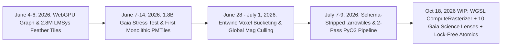

# Comprehensive Code Review & Technical Audit: ArrowTiles + DeepGraph

> [!WARNING]
> **Post-Verification Errata (2026-11-19 — see [`docs/PROGRESS_2026-11.md`](../docs/PROGRESS_2026-11.md) & [`2026-11-19_05_PLAN`](2026-11-19_05_PLAN_all_merged-consensus-revival-plan.md)):**
> 1. **Finding `F-05` ("Supergiants with `abs_m <= 0.0` culled") is false for Gaia:** Verified across all `1,348,176,623` rows of `s3_cache/batch_*.parquet` that `abs_m` stores apparent G-band magnitude (`min = 1.9425`, `max = 21.4851`, `0` rows $\le 0$). The real underlying bug is `pmtiles.worker.ts` ignoring Arrow `nullBitmap` (turning SQL `NULL`s in `radial_velocity`, `teff_gspphot`, and `parallax` into `0.0`); Phase 3 renames the Gaia preset column to `phot_g_mean_mag` (retaining legacy `abs_m` viewer compatibility).
> 2. **Finding `F-03` remediation ("Move ACES Filmic + sRGB to `fs_main`"):** Moving tone mapping out of `splat_pixel` would darken sparse Milky Way dust lanes ~6× and invalidate Science Lens presets (`ComputeRasterizer.ts` intentionally mirrors Three.js's fragment-before-8-bit-blend curve). Phase 5b widens `accumBuffer` to `2 × atomic<u32>` while preserving the per-point curve by default (`D10`).
> 3. **Finding `B-13` ("Release Python GIL around `reader.next()`"):** Dropped—provides zero CLI throughput benefit and risks PyArrow/DuckDB C-stream GIL invariants.

**Date:** 2026-11-19  
**Audit Mode:** Strictly Read-Only Multi-Agent Full Review (`/comprehensive-review-full-review`)  
**Repositories Audited:**
- **Backend / Format Pipeline:** [`duckdb-arrowtiles`](file:///D:/exploratory/duckdb-extension/duckdb-arrowtiles) (`HEAD`: `fcf2950` on `revival/2026-11-wip`, ahead of `main` `c789fa0`)
- **Frontend / WebGPU Engine:** [`deepgraph-arrowtiles-sandbox`](file:///D:/exploratory/duckdb-extension/deepgraph-arrowtiles-sandbox) (`HEAD`: `e09fd85` on `revival/2026-11-wip`, ahead of `main` `86d003e`)

> [!IMPORTANT]
> **Live Workspace State & Hygiene:** Both repositories recently had their October 18, 2026 work-in-progress snapshotted onto `revival/2026-11-wip` (`fcf2950` and `e09fd85`). This audit inspected every line of both the `main` baseline, legacy feature branches (`perf/backend-optimizations`, `perf/pmtiles-schema-injection`), and the `revival/2026-11-wip` tip—including the 1,587-line WGSL compute engine in [ComputeRasterizer.ts](file:///D:/exploratory/duckdb-extension/deepgraph-arrowtiles-sandbox/src/core/ComputeRasterizer.ts) and the 3-tier lock-free atomic quadtree in [lib.rs](file:///D:/exploratory/duckdb-extension/duckdb-arrowtiles/arrowtiles-engine/src/lib.rs)—without modifying any workspace files or reading CC BY-NC-SA `deepscatter*` code.

---

## 1. Executive Scorecard & Health Metrics

| Review Dimension | Backend (`duckdb-arrowtiles`) | Frontend (`deepgraph-arrowtiles-sandbox`) | Key Takeaway |
| :--- | :---: | :---: | :--- |
| **Core Architecture** | **B+** | **B** | Brilliant end-to-end zero-copy thesis (DuckDB external sort -> PyO3 CFFI -> PMTiles Zstd Arrow IPC -> Web Worker -> WebGPU VRAM), strained by organic prototype accretion in [main.ts](file:///D:/exploratory/duckdb-extension/deepgraph-arrowtiles-sandbox/src/main.ts) (909 lines) and split rendering paths. |
| **Algorithmic & Shader Math** | **C+** | **C+** | Impressive Hammer projections, 6D Galactic kinematics, and Hilbert indexing, undermined by WGSL packed-`u32` atomic carry races, $M_G \le 0$ supergiant erasure, `f32` deep-zoom cancellation, and $O(4^Z)$ non-spatial quadtree blowup. |
| **Memory & Concurrency** | **C+** | **C** | Rayon `into_par_iter()` causes non-deterministic priority inversion; Pass 1 `ArrowWriter` hides a 15.7M-row RAM buffer; frontend retains 2+ GB of unused CPU `TypedArray`s and leaks `GPUBuffer`s across dataset swaps. |
| **Security & Input Resilience** | **C-** | **D+** | LAN-exposed Vite range plugin (`host: true`) has unauthenticated path traversal + `Buffer.allocUnsafe` 31 GB crash; backend interpolates raw paths into SQL with `allow_unsigned_extensions='true'` and breaks on a single `NaN`. |
| **Testing & CI/CD** | **F** | **D-** | Backend has 0 tracked `pytest` or `cargo test` suites (`archive/tests/` is gitignored and 8/11 scripts are broken/obsolete); frontend CI runs Playwright on a 404 empty canvas with 0 tiles loaded. |
| **Documentation & Spec Parity** | **C** | **C+** | `START_HERE.md` is an exemplary onboarding doc, but formal `.arrowtiles` wire spec is absent and `README.md` in both repos drifts from the October 2026 implementation. |

**Verified Local Toolchain Environment:**
- **Node / npm:** `v24.12.0` / `11.6.2` (`npx tsc --noEmit` passes with 0 errors)
- **Rust / Cargo:** `1.96.1 (31fca3adb 2026-06-26)`
- **Python / DuckDB / PyArrow:** `Python 3.14.2`, `duckdb 1.5.3`, `pyarrow 24.0.0`

---

## 2. Institutional Archaeology: How the Codebase Reached This State

Synthesizing 40+ historical engineering logs in `duckdb-arrowtiles/logs/` and `deepgraph-arrowtiles-sandbox/logs/old/` clarifies **why** the architecture looks the way it does and which hard-won lessons must never be regressed during revival:

### Hard-Won Lessons Preserved from `logs/` (Do Not Regress!)
1. **Why `duckdb-rs` UDFs were replaced by 2-Pass DuckDB -> PyO3 Arrow C Stream:** Running stateful Rust scalar UDFs inside DuckDB over 1.8B rows leaked orphaned chunk buffers to **31.4 GB RSS** until OOM-killed and suffered `DashMap` lock contention (`ducklake-architecture_2026_07_08.md`, `2026-06-29-arrowtiles-critical-review.md`).
2. **Why Geometric Voxel Bucketing + Global Magnitude Culling co-exist:** Pure global brightness sorting spent 100% of `Z=0` capacity on the Galactic Equator, leaving sky corners blank (`2026-06-29_entwine_arrowtiles_architecture_review.md`). Conversely, capping tiles locally on the frontend (`100,000` rows) chopped faint stars in the core while keeping faint noise in sparse sky, creating harsh **checkerboard seams** (`deepgraph_engineering_summary_2026_07_01.md`).
3. **Why LOD is decoupled from live HTTP queue depth:** Coupling Screen-Space Error to `pendingRequests.size` caused infinite request/abort thrashing and an additive-blending "wall of mud" that required a hard rollback (`Dynamic_LOD_and_Additive_Blending_Rollback_2026-06-09.md`).
4. **Why October 18, 2026 WIP (`e09fd85` / `fcf2950`) is so significant:** In July 2026 (`gaia_mulitdimensional_2026_07_07.md`), the creator dreamed of interactive 6D GPU Star Trails (+400 kyr to +1.6 Myr) and 10 astrophysical Gaia lenses ahead of **ESA Gaia DR4 (December 2026)**. In October 2026, those exact **10 ESA Gaia Science Lenses + WGSL `ComputeRasterizer`** were built on the frontend alongside a **lock-free 3-tier atomic bucketer + parallel Zstd packer** on the backend—**but the Rust engine was never recompiled into `.pyd`, leaving the October backend untested and shadowed!**

---

## 3. Master Prioritized Findings Registry

### P0 — Critical Issues (Immediate Blockers: Silent Corruption, Tab/Node Crashes, Security, Stale Binaries)

| ID | Repo | Location | Finding & Mechanism | Concrete Remediation |
| :--- | :---: | :--- | :--- | :--- |
| **B-01** | Backend | [arrowtiles_core.pyd](file:///D:/exploratory/duckdb-extension/duckdb-arrowtiles/arrowtiles_core.pyd), [arrowtiles.py](file:///D:/exploratory/duckdb-extension/duckdb-arrowtiles/arrowtiles.py#L80-L95) | **Stale `./arrowtiles_core.pyd` (`2026-07-22`) in repo root shadows `site-packages` (`2026-07-19`) and lags [lib.rs](file:///D:/exploratory/duckdb-extension/duckdb-arrowtiles/arrowtiles-engine/src/lib.rs) (`2026-10-18`) by 3 months.** Because Python searches CWD (`sys.path[0]`) first, running `python arrowtiles.py` executes the July binary (missing `init_threadpool`, using `Float32` coords, 2 GiB `BloomFilter`, and `std::ptr::read` UB). | Delete untracked root `arrowtiles_core.pyd`, add a PEP 517 `pyproject.toml`, and rebuild via `maturin develop --release`. |
| **B-02** | Backend | [arrowtiles.py](file:///D:/exploratory/duckdb-extension/duckdb-arrowtiles/arrowtiles.py#L381-L387), [lib.rs](file:///D:/exploratory/duckdb-extension/duckdb-arrowtiles/arrowtiles-engine/src/lib.rs#L75-L89), [lib.rs](file:///D:/exploratory/duckdb-extension/duckdb-arrowtiles/arrowtiles-engine/src/lib.rs#L227-L242) | **Column collision on CLI default `x_norm`/`y_norm` and reserved names (`z`, `x_u16`, `y_u16`, `final_tile_id`).** `SELECT *, CAST(...) AS x_norm` produces duplicate `x_norm` columns; `batch.column_by_name("x_norm")` reads index 0 (**unnormalized**!), clamping coords to `[0, 1]`. Any 3D dataset with a `z` column duplicates `"z"` in `output_schema` and crashes `RecordBatch::try_new` (or drains `tid_builder` twice). | Use internal names `__at_x_norm`, `__at_y_norm` (stripped in Rust) and reject/namespace reserved column names (`z`, `x_u16`, `y_u16`, `final_tile_id`). |
| **B-03** | Backend | [arrowtiles.py](file:///D:/exploratory/duckdb-extension/duckdb-arrowtiles/arrowtiles.py#L307-L334), [arrowtiles.py](file:///D:/exploratory/duckdb-extension/duckdb-arrowtiles/arrowtiles.py#L379-L386), [lib.rs](file:///D:/exploratory/duckdb-extension/duckdb-arrowtiles/arrowtiles-engine/src/lib.rs#L153-L156), [lib.rs](file:///D:/exploratory/duckdb-extension/duckdb-arrowtiles/arrowtiles-engine/src/lib.rs#L448-L456) | **Single `NaN`/`±Inf` row crashes `build_generic` SQL or silently wipes all PMTiles metadata.** In DuckDB 1.5.3, `'NaN'::DOUBLE IS NOT NULL` is `True` and `MAX(col)` returns `nan`. A single `NaN` in `x`/`y` interpolates `/ nan` (`Binder Error: column "nan" not found`). A single `NaN` in *any* numeric column causes `json.dumps` to emit invalid `NaN` JSON, which `serde_json` rejects at `lib.rs:448`—**silently discarding the entire metadata config**! Worse, `lib.rs:153-156` maps any `NULL`/`NaN` coords to `(0.5, 0.5)`, fabricating a dense center spike. | Filter `isfinite(x) AND isfinite(y)` in SQL; use `MIN(c) FILTER (WHERE isfinite(c))`; pass `allow_nan=False` to `json.dumps`; error instead of ignoring bad metadata JSON in Rust; skip non-finite rows in bucketer. |
| **B-04** | Backend | [arrowtiles.py](file:///D:/exploratory/duckdb-extension/duckdb-arrowtiles/arrowtiles.py#L38), [arrowtiles.py](file:///D:/exploratory/duckdb-extension/duckdb-arrowtiles/arrowtiles.py#L160-L196), [arrowtiles.py](file:///D:/exploratory/duckdb-extension/duckdb-arrowtiles/arrowtiles.py#L296-L385) | **SQL injection + `allow_unsigned_extensions: 'true'` RCE hazard.** `input_parquet` and `part` are interpolated unescaped into `read_parquet('{path}')` at 9 call sites (breaking on paths like `O'Connor` and allowing SQL breakout to `LOAD` unsigned native binaries). | Remove `'allow_unsigned_extensions': 'true'` (unused since `lindel` was dropped) and parameterize paths or escape `'` -> `''`. |
| **B-05** | Backend | [lib.rs](file:///D:/exploratory/duckdb-extension/duckdb-arrowtiles/arrowtiles-engine/src/lib.rs#L25-L32), [lib.rs](file:///D:/exploratory/duckdb-extension/duckdb-arrowtiles/arrowtiles-engine/src/lib.rs#L376-L385), [lib.rs](file:///D:/exploratory/duckdb-extension/duckdb-arrowtiles/arrowtiles-engine/src/lib.rs#L529-L596) | **Panics across PyO3 FFI & raw `usize` pointer UB.** `finalize()` calls `self.writer.as_mut().unwrap()` (`L587`) *before* `self.writer.take().ok_or_else(...)` (`L594`), panicking on double-finalize; `L385` slices `&sink[global_schema_size..]` without guarding `sink.len() < global_schema_size`; `take_ffi_stream` casts arbitrary Python `usize` to `*mut FFI_ArrowArrayStream` (segfault on bad arg, and leaks CFFI stream if PyO3 arg parsing fails beforehand). | Replace `.unwrap()` with `.ok_or_else(...)`, guard `sink.len() < global_schema_size + 8`, and migrate from `pyarrow.cffi` `usize` pointers to PyCapsules (`__arrow_c_stream__`). |
| **F-01** | Frontend | [PMTilesClient.ts](file:///D:/exploratory/duckdb-extension/deepgraph-arrowtiles-sandbox/src/PMTilesClient.ts#L447-L497), [main.ts](file:///D:/exploratory/duckdb-extension/deepgraph-arrowtiles-sandbox/src/main.ts#L290-L291) | **Exponential $O(4^Z)$ main-thread freeze/crash in HR Diagram & non-spatial Chart Mode.** When `isSpatialX=false` and `isSpatialY=false`, `cullX` and `cullY` are both `false`. Scrolling to zoom in (`currentZ = 8..14`) recursively enumerates and sorts **87,381 to 357,913,941 quadtree nodes** on the UI thread, hanging/crashing the browser tab immediately. | When `!isSpatialX && !isSpatialY`, clamp `z` traversal in `getVisibleTiles` to `Math.min(z, 2)` (21 global sample tiles) or traverse sequentially by `tile_id` up to `budget`. |
| **F-02** | Frontend | [vite.config.ts](file:///D:/exploratory/duckdb-extension/deepgraph-arrowtiles-sandbox/vite.config.ts#L45-L99), [vite.config.ts](file:///D:/exploratory/duckdb-extension/deepgraph-arrowtiles-sandbox/vite.config.ts#L110-L115) | **LAN-exposed (`host: true`) Path Traversal + Unbounded `Buffer.allocUnsafe` Crash.** `arrowtilesFastRangePlugin` runs before Vite's `fs.strict` middleware without verifying `resolvedPath.startsWith(allowedRoot)` (exposing any `.arrowtiles` file on the machine to LAN peers), crashes Node on malformed `%` (`decodeURIComponent` `URIError`), and calls `Buffer.allocUnsafe(chunkLen)` uncapped (`Range: bytes=0-` on 15.8–31 GB `gaia_full.arrowtiles` throws `ERR_OUT_OF_RANGE` and kills Vite). | Bind `host: '127.0.0.1'` by default, wrap `decodeURIComponent` in `try/catch`, enforce `path.relative` root containment, cap single range reads to e.g. `16 MiB`, and validate `stat.mtimeMs` on cached FDs. |
| **F-03** | Frontend | [ComputeRasterizer.ts](file:///D:/exploratory/duckdb-extension/deepgraph-arrowtiles-sandbox/src/core/ComputeRasterizer.ts#L469-L544) | **WGSL TOCTOU atomic race & intra-word bit-carry corruption across all compute modes.** Non-atomic `atomicLoad` saturation checks followed by `atomicAdd` on bit-packed `u32` pixels (`11-11-10` RGB in Modes 0/1/3; `20-12` `valSum\|wSum` in Mode 2; `19-10-3` in Mode 4) race when hundreds of threads hit the Galactic Center simultaneously: **3 threads** wrap 10-bit Blue (`1024 -> 0`, turning white cores orange/yellow); **6 threads** overflow `valSum` into `wSum` in Mode 2 (inverting peak colors to `0.0`); **2 threads** wrap 3-bit `lineHits` in Mode 4. Also `splat_pixel` (`L483`) applies ACES + sRGB gamma *per star before summing* instead of in the Resolve pass. | Use two `atomic<u32>` words per pixel (`8 bytes/pixel`, e.g., `RG_16_16` + `BA_16_16` linear fixed-point, or separate `valSum` and `wSum` `u32` words) or a saturating `atomicCompareExchangeWeak` loop, and move ACES + sRGB into `fs_main`. |
| **F-04** | Frontend | [memory-leak.spec.ts](file:///D:/exploratory/duckdb-extension/deepgraph-arrowtiles-sandbox/tests/memory-leak.spec.ts#L10-L66), [perf-ci.yml](file:///D:/exploratory/duckdb-extension/deepgraph-arrowtiles-sandbox/.github/workflows/perf-ci.yml#L18-L33), [playwright.config.ts](file:///D:/exploratory/duckdb-extension/deepgraph-arrowtiles-sandbox/playwright.config.ts#L20) | **100% vacuous Playwright E2E test & broken CI config.** In CI, `/gaia_full.arrowtiles` does not exist (404), `tileManager` stays `null`, the animation loop exits at line 1, and the test pans 20 times over an idle empty canvas while `globalThis.gc` is `undefined` and `--use-angle=swiftshader` targets WebGL instead of WebGPU. Also `node-version: '20'` risks failing `vite@8.1.3` (`^20.19.0 \|\| >=22.12.0`). | Commit/generate a deterministic `<5 MB` fixture `.arrowtiles`, assert active tiles/points > 0, instrument `GPUDevice.createBuffer`/`destroy` byte counters, use Node 22+, and separate CI smoke vs. real-GPU VRAM tests. |

---

### P1 — High Priority Issues (Correctness, Reproducibility, Astrophysics, VRAM & Scaling)

#### Backend (`duckdb-arrowtiles`)
1. **[B-06] `--resume` is broken by `TemporaryDirectory` auto-deletion, while non-resume mode packs stale partitions** ([arrowtiles.py](file:///D:/exploratory/duckdb-extension/duckdb-arrowtiles/arrowtiles.py#L29-L36), [arrowtiles.py](file:///D:/exploratory/duckdb-extension/duckdb-arrowtiles/arrowtiles.py#L88-L100), [arrowtiles.py](file:///D:/exploratory/duckdb-extension/duckdb-arrowtiles/arrowtiles.py#L219-L221), [arrowtiles.py](file:///D:/exploratory/duckdb-extension/duckdb-arrowtiles/arrowtiles.py#L421-L425)):
   - Without `--temp-dir`, `self._temp_dir_obj = tempfile.TemporaryDirectory(...)` deletes all Pass 1 partitions the instant Python exits on a Pass 2 error—right after printing *"Partition files preserved... for --resume"*! And `--resume` then looks in `./duckdb_temp` instead of `duckdb_temp_<random>`. Conversely, with `--temp-dir` and `resume=False`, existing `z_*.parquet` files are never cleaned before Pass 1, contaminating new builds with stale deep-zoom partitions.
2. **[B-07] Non-deterministic priority inversion (`into_par_iter`) & `AtomicU32` wraparound** ([lib.rs](file:///D:/exploratory/duckdb-extension/duckdb-arrowtiles/arrowtiles-engine/src/lib.rs#L152-L210)):
   - Within each 100k-row batch, Rayon threads race with `Ordering::Relaxed` to claim `coarse_bitsets` (`Z=0..6`) and `mid_counts` (`Z=7..9`), allowing row `99,999` to beat row `0` (the brightest star in the sky) into `Z=0` and producing byte-different outputs on every run.
   - `mid_counts` and `deep_counts` call `fetch_add(1)` unconditionally even after tiles saturate (`>= tile_capacity`), causing severe cache-line bouncing and wrapping `u32::MAX -> 0` after $4.29 \times 10^9$ probes on ultra-dense datasets.
3. **[B-08] Hidden 15.7M-row RAM buffer in Pass 1 `ArrowWriter` + unbounded `Z = max_zoom` single-tile RAM** ([lib.rs](file:///D:/exploratory/duckdb-extension/duckdb-arrowtiles/arrowtiles-engine/src/lib.rs#L122), [lib.rs](file:///D:/exploratory/duckdb-extension/duckdb-arrowtiles/arrowtiles-engine/src/lib.rs#L180-L181), [lib.rs](file:///D:/exploratory/duckdb-extension/duckdb-arrowtiles/arrowtiles-engine/src/lib.rs#L275-L280), [lib.rs](file:///D:/exploratory/duckdb-extension/duckdb-arrowtiles/arrowtiles-engine/src/lib.rs#L517-L574)):
   - `parquet::ArrowWriter` defaults `max_row_group_size` to `1,048,576` rows. Keeping 15 writers (`z=0..14`) open simultaneously buffers up to **15.73 million uncompressed rows** in Rust RAM outside DuckDB's `memory_limit` (5–30+ GB on wide/text schemas like LMSys!).
   - At `z == effective_max_zoom`, `claimed = true` preserves row conservation (0 rows dropped), **but** `ArrowTilesPacker` concatenates an entire tile into a single `RecordBatch` in 4 in-RAM copies (`current_batches`, `concat_batches`, `sink`, `compressed_bytes`), while the frontend ([Scatterplot.ts](file:///D:/exploratory/duckdb-extension/deepgraph-arrowtiles-sandbox/src/Scatterplot.ts#L27), [Scatterplot.ts](file:///D:/exploratory/duckdb-extension/deepgraph-arrowtiles-sandbox/src/Scatterplot.ts#L905)) **silently truncates every tile at `rowsPerTile = 262,144`**!
4. **[B-09] `grid_size` squaring bug inflates `tile_capacity` by 2.62x–4.0x + `Z=6 -> Z=7` density jump** ([arrowtiles.py](file:///D:/exploratory/duckdb-extension/duckdb-arrowtiles/arrowtiles.py#L76), [lib.rs](file:///D:/exploratory/duckdb-extension/duckdb-arrowtiles/arrowtiles-engine/src/lib.rs#L97-L106), [lib.rs](file:///D:/exploratory/duckdb-extension/duckdb-arrowtiles/arrowtiles-engine/src/lib.rs#L182-L198)):
   - `max_capacity = 100,000` -> `grid_size = 512` -> `tile_capacity = 512 * 512 = 262,144` (2.62x requested capacity!). And switching abruptly from 1-point-per-cell bitsets at `Z <= 6` to flat scalar capacity counters at `Z >= 7` causes localized clusters to jump from ~50 points at `Z=6` to `262,144` overlapping points at `Z=7`, starving sparse regions of that tile.
5. **[B-10] Categorical / Dictionary column pitfalls** ([arrowtiles.py](file:///D:/exploratory/duckdb-extension/duckdb-arrowtiles/arrowtiles.py#L146-L192), [arrowtiles.py](file:///D:/exploratory/duckdb-extension/duckdb-arrowtiles/arrowtiles.py#L300), [arrowtiles.py](file:///D:/exploratory/duckdb-extension/duckdb-arrowtiles/arrowtiles.py#L337-L348), [lib.rs](file:///D:/exploratory/duckdb-extension/duckdb-arrowtiles/arrowtiles-engine/src/lib.rs#L368-L386)):
   - Input Parquet `Dictionary` / `ENUM` columns (like `test_categorical_dict.parquet`) either get decoded to `VARCHAR` in Pass 1 (losing dictionary compression if `>256` categories) or fail `DESCRIBE` `VARCHAR` detection if already `ENUM`; `count_dist == 256` promotes DuckDB `ENUM` indices from `uint8` to `uint16`; and per-tile `StreamWriter` re-embeds redundant `DictionaryBatch` messages into every single tile.
6. **[B-11] Y-axis inversion mismatch (`build_gaia` vs `build_generic`), aspect-ratio stretching, & 16 B/row raw `x, y` bloat** ([arrowtiles.py](file:///D:/exploratory/duckdb-extension/duckdb-arrowtiles/arrowtiles.py#L259), [arrowtiles.py](file:///D:/exploratory/duckdb-extension/duckdb-arrowtiles/arrowtiles.py#L322-L325), [arrowtiles.py](file:///D:/exploratory/duckdb-extension/duckdb-arrowtiles/arrowtiles.py#L382-L385)):
   - `build_gaia` flips `1.0 - y` (`+y` up -> PMTiles `iy=0` top), while `build_generic` omits `1.0 -` (mirroring generic plots vertically). `build_generic` also stretches non-square domains anisotropically and retains raw `DOUBLE` `x, y` columns inside every tile alongside `x_u16, y_u16` (verified in `test.arrowtiles`).

#### Frontend (`deepgraph-arrowtiles-sandbox`)
7. **[F-05] All supergiants and luminous stars with `abs_m <= 0.0` are culled in Gaia modes** ([ComputeRasterizer.ts](file:///D:/exploratory/duckdb-extension/deepgraph-arrowtiles-sandbox/src/core/ComputeRasterizer.ts#L584-L587), [Scatterplot.ts](file:///D:/exploratory/duckdb-extension/deepgraph-arrowtiles-sandbox/src/Scatterplot.ts#L576), [Scatterplot.ts](file:///D:/exploratory/duckdb-extension/deepgraph-arrowtiles-sandbox/src/Scatterplot.ts#L650)):
   - Both shaders discard `rawSize <= 0.0` (`sizeField.greaterThan(0.0)`), erasing every O/B/A star, giant, and supergiant brighter than $M_G = 0.0$ (even though `gaiaFallbacks.abs_m.min = -2.0` in [main.ts](file:///D:/exploratory/duckdb-extension/deepgraph-arrowtiles-sandbox/src/main.ts#L163) and real Gaia stars reach $M_G \approx -10$), because missing columns in [pmtiles.worker.ts](file:///D:/exploratory/duckdb-extension/deepgraph-arrowtiles-sandbox/src/pmtiles.worker.ts#L210) were filled with `0.0` instead of `NaN`.
8. **[F-06] Sticky `state.flipY = true` after HR Diagram inverts all 10 Gaia Sky Lenses & desyncs frustum culling** ([main.ts](file:///D:/exploratory/duckdb-extension/deepgraph-arrowtiles-sandbox/src/main.ts#L289), [main.ts](file:///D:/exploratory/duckdb-extension/deepgraph-arrowtiles-sandbox/src/main.ts#L323), [main.ts](file:///D:/exploratory/duckdb-extension/deepgraph-arrowtiles-sandbox/src/main.ts#L339-L567)):
   - Selecting HR Diagram sets `state.flipY = true` (`L531`), and none of Lenses #1–#10 reset it; `Gaia Baseline` forces `currentFlipY = false` for tile culling (`L289`) while passing `state.flipY` (`[-1, 1]`) to the shader (`L323`), rendering the Milky Way upside-down while culling the wrong hemisphere into black voids.
9. **[F-07] Float32 catastrophic cancellation in `ComputeRasterizer` at deep zoom (`Z >= 12`)** ([ComputeRasterizer.ts](file:///D:/exploratory/duckdb-extension/deepgraph-arrowtiles-sandbox/src/core/ComputeRasterizer.ts#L595-L624), [Renderer.ts](file:///D:/exploratory/duckdb-extension/deepgraph-arrowtiles-sandbox/src/core/Renderer.ts#L88)):
   - Unlike `Scatterplot.ts` (which stores `tileOffset` in `Float64` `mesh.position`), `ComputeRasterizer` evaluates `u.tileOffsetX + (rawX + jitterX) * u.tileScale` and `worldX - u.camLeft` in `f32`. At `Z=14`, `u16` tile resolution ($9.3 \times 10^{-10}$) is **64x finer than `f32` ULP** ($5.96 \times 10^{-8}$), rounding `jitterX` to zero and causing 32-pixel camera stepping at `zoom = 10^6`. Pre-subtracting `camCenter` from `tileWorldOffset` in `Float64` on the CPU (Relative-to-Eye / RTC) eliminates this completely.
10. **[F-08] 2+ GB unused CPU `TypedArray`s & permanent VRAM leak across dataset/column swaps** ([Scatterplot.ts](file:///D:/exploratory/duckdb-extension/deepgraph-arrowtiles-sandbox/src/Scatterplot.ts#L223-L253), [Scatterplot.ts](file:///D:/exploratory/duckdb-extension/deepgraph-arrowtiles-sandbox/src/Scatterplot.ts#L781-L802), [WebGPUAdapter.ts](file:///D:/exploratory/duckdb-extension/deepgraph-arrowtiles-sandbox/src/WebGPUAdapter.ts#L17-L76)):
    - `writeColumnToSlotGPU` allocates a 1.05 MB CPU `Float32Array(262144)` per slot per column solely so `WebGPUAdapter` can read `attribute.array.byteLength`, leaving **2.15 GB (Gaia) to 10.2 GB (38-col LMSys)** of all-zero JS arrays in RAM while `clearAllTiles()` never calls `gpuBuffer.destroy()` or `geometry.dispose()`.
11. **[F-09] Detached `ArrayBuffer` & stale `slotToTileData` hazard on `setRequestedColumns()`** ([PMTilesClient.ts](file:///D:/exploratory/duckdb-extension/deepgraph-arrowtiles-sandbox/src/PMTilesClient.ts#L167-L197), [Scatterplot.ts](file:///D:/exploratory/duckdb-extension/deepgraph-arrowtiles-sandbox/src/Scatterplot.ts#L282-L290), [Scatterplot.ts](file:///D:/exploratory/duckdb-extension/deepgraph-arrowtiles-sandbox/src/Scatterplot.ts#L826-L886)):
    - For `>12`-column datasets (like 38-col LMSys), changing columns recycles active `ArrayBuffer`s into `bufferPool` (which transfers/detaches them to Web Workers) without calling `onTileUnloaded`; `Scatterplot.slotToTileData` retains detached 0-byte buffers and binds 0-byte `Float32Array(0)` vertex attributes during transitions.
12. **[F-10] Dual-renderer divergence & unclamped `zoomTUniform`** ([main.ts](file:///D:/exploratory/duckdb-extension/deepgraph-arrowtiles-sandbox/src/main.ts#L811-L817), [Scatterplot.ts](file:///D:/exploratory/duckdb-extension/deepgraph-arrowtiles-sandbox/src/Scatterplot.ts#L298-L350), [Renderer.ts](file:///D:/exploratory/duckdb-extension/deepgraph-arrowtiles-sandbox/src/core/Renderer.ts#L164)):
    - Axis transitions temporarily switch from `ComputeRasterizer` to `Scatterplot` for 2 seconds and then snap back; `Scatterplot` lacks Modes 2–4, `esa_*` colormaps, `invertScale`, `lightBackground`, and NaN coordinate culling, while unclamped `zoomTUniform` (`3.32` at max zoom) bloats instanced point sizes 31x. Also `currentZoomUniform` (`Scatterplot.ts:143`) is dead after cluster-boosting logic from `d6d17eb` was lost in `e349d20`.

---

### P2 & P3 — Medium / Low Priority Findings (Hygiene, Latency, Packaging, Docs)

- **[B-12 / P2] PMTiles header `max_zoom` hardcoded to `22` & non-atomic output creation** ([lib.rs](file:///D:/exploratory/duckdb-extension/duckdb-arrowtiles/arrowtiles-engine/src/lib.rs#L461-L468)): `PmTilesWriter` omits `.min_zoom(0).max_zoom(max_zoom)` (writing `max_z=22` into `test.arrowtiles`), lacks a monotonic `tid > prev_tid` assertion, and writes directly to `output_path` instead of `<output_path>.tmp` + rename.
- **[B-13 / P2] Unnecessary Python GIL retention during Pass 1 & Pass 2** ([lib.rs](file:///D:/exploratory/duckdb-extension/duckdb-arrowtiles/arrowtiles-engine/src/lib.rs#L128), [lib.rs](file:///D:/exploratory/duckdb-extension/duckdb-arrowtiles/arrowtiles-engine/src/lib.rs#L483-L599)): `Python::with_gil(|_py| reader.next())` holds the GIL across DuckDB's entire Pass 1 sort even though `ArrowArrayStreamReader` is pure C ABI; `process_batch` and `finalize` also hold the GIL during `XxHash3_64` dedup and Gzip directory writes.
- **[B-14 / P2] `u16` boundary half-bin bias & per-tile FlatBuffer `Schema` re-serialization** ([lib.rs](file:///D:/exploratory/duckdb-extension/duckdb-arrowtiles/arrowtiles-engine/src/lib.rs#L203-L204), [lib.rs](file:///D:/exploratory/duckdb-extension/duckdb-arrowtiles/arrowtiles-engine/src/lib.rs#L368-L384)): `(local_x * 65535.0).round()` gives bins `0` and `65535` half-width and maps `local_x ≈ 1.0` onto the neighbor tile's left edge; instantiating `StreamWriter` per tile rebuilds and discards the FlatBuffer `Schema` on every tile.
- **[F-11 / P2] $O(N)$ main-thread work in `computeSlotMagBins` & main-thread `fflate` Gzip** ([Scatterplot.ts](file:///D:/exploratory/duckdb-extension/deepgraph-arrowtiles-sandbox/src/Scatterplot.ts#L636-L665), [PMTilesClient.ts](file:///D:/exploratory/duckdb-extension/deepgraph-arrowtiles-sandbox/src/PMTilesClient.ts#L5), [PMTilesClient.ts](file:///D:/exploratory/duckdb-extension/deepgraph-arrowtiles-sandbox/src/PMTilesClient.ts#L235)): Deep `Z >= 5` tiles have zero `abs_m <= 13.5` stars (`bin 0` stays `0`), forcing `computeSlotMagBins` to scan all `262,144` floats on the main thread; `fflate` is imported directly in `PMTilesClient.ts` without being declared in [package.json](file:///D:/exploratory/duckdb-extension/deepgraph-arrowtiles-sandbox/package.json).
- **[F-12 / P2] Worker & memory pool cleanup gaps + Mode 4 edge OOB** ([PMTilesClient.ts](file:///D:/exploratory/duckdb-extension/deepgraph-arrowtiles-sandbox/src/PMTilesClient.ts#L102-L110), [PMTilesClient.ts](file:///D:/exploratory/duckdb-extension/deepgraph-arrowtiles-sandbox/src/PMTilesClient.ts#L313-L326), [ComputeRasterizer.ts](file:///D:/exploratory/duckdb-extension/deepgraph-arrowtiles-sandbox/src/core/ComputeRasterizer.ts#L809-L810)): `bufferPool.rawPayload` is pushed on abort and never popped or cleared; `destroy()` leaks `bufferPool.columns`, `queue`, and 15s timers; `loadDataset` creates `new PMTiles` twice; Mode 4 `seedIdx` omits `cpy < i32(u.screenHeight)` when `ndcY = 1.0 - 2^-24` rounds `fy` up to `screenHeight`.
- **[F-13 & B-15 / P3] Unused dependencies, dead files, unclosed Windows handles, & doc drift**:
  - Frontend has 6 unused dependencies in [package.json](file:///D:/exploratory/duckdb-extension/deepgraph-arrowtiles-sandbox/package.json#L19-L29) (`@sentry/browser`, `@sentry/tracing`, `gl-matrix`, `@types/gl-matrix`, `stats.js`, `@types/stats.js`), dead [ui.ts](file:///D:/exploratory/duckdb-extension/deepgraph-arrowtiles-sandbox/src/ui.ts) and [counter.ts](file:///D:/exploratory/duckdb-extension/deepgraph-arrowtiles-sandbox/src/counter.ts), empty 0-byte [compute_test.mjs](file:///D:/exploratory/duckdb-extension/deepgraph-arrowtiles-sandbox/tests/compute_test.mjs), and `"build": "vite build"` without `tsc --noEmit`.
  - Backend lacks `self.con.close()` (causing Windows `WinError 32` temp-dir lock warnings), uses `pyo3-log = "*"` wildcard in [Cargo.toml](file:///D:/exploratory/duckdb-extension/duckdb-arrowtiles/arrowtiles-engine/Cargo.toml#L14), and [README.md](file:///D:/exploratory/duckdb-extension/duckdb-arrowtiles/README.md) still instructs `INSTALL lindel`, omits `--dataset gaia`, and references deleted `src/bin/{bucketer,packer}.rs` in [START_HERE.md](file:///D:/exploratory/duckdb-extension/duckdb-arrowtiles/START_HERE.md#L83).
