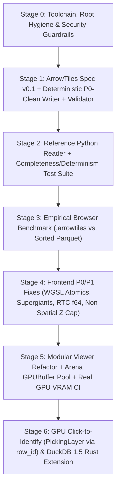

# Deep Research (2025–2026) & Revival Strategy: ArrowTiles + DeepGraph

**Date:** 2026-11-19  
**Research Scope:** Competitive Landscape, Cloud-Native Spatial/Columnar Formats, Arrow IPC Wire Framing, DuckDB 1.5+ Native Rust Extensions, Open-Spec Licensing, and Sequenced Revival Architecture

> [!TIP]
> **Why Reviving ArrowTiles + DeepGraph Right Now (November 2026) Is Extraordinarily Timely:**
> 1. **Clear Market & Open-Standard Gap:** Apple's MIT-licensed `embedding-atlas` proved massive demand in 2025–2026 for GPU-accelerated embedding exploration, **but hits an in-VRAM ceiling around ~5M–10M points** with no out-of-core tiling, while billion-point/graph alternatives (`deepscatter`, `cosmograph`) lock out commercial engineering teams via `CC BY-NC` licenses.
> 2. **DuckDB 1.5.0 Unlocked Pure-Rust `COPY ... TO (FORMAT ARROWTILES)`:** DuckDB 1.5.0 added native `CopyFunction` hooks to the stable **C Extension API** (`quack-rs` / `extension-template-rs`), eliminating the C++ rewrite and Windows MSVC ABI clashes that forced your July 2026 pivot—and your workstation **already runs `duckdb 1.5.3` and `rustc 1.96.1`**.
> 3. **ESA Gaia DR4 Arrives Next Month (December 2026):** Your October 2026 WGSL `ComputeRasterizer` + 10 Gaia Science Lenses position DeepGraph to be the showcase browser observatory for Gaia DR4 alongside multi-million-row AI embedding maps.

---

## 1. Competitive Landscape (2025–2026): Where ArrowTiles + DeepGraph Wins

| Engine / Project | GPU Backend | Max Practical Scale | Out-of-Core Single-File Tiling? | Data / Query Layer | Standout Capabilities | License |
| :--- | :--- | :--- | :--- | :--- | :--- | :--- |
| **Apple Embedding Atlas**<br>([`apple/embedding-atlas`](https://github.com/apple/embedding-atlas), [`arXiv:2505.06386`](https://arxiv.org/abs/2505.06386)) | **WebGPU** (WebGL2 fallback) | **~1M – 10M** points (in-core `maxBufferSize` / VRAM bound) | **No** (loads full coordinate columns into GPU memory) | **DuckDB** / **DuckDB-WASM** + Parquet | Order-independent transparency (OIT), real-time 2D KDE contours, Rust->WASM density auto-labeling, FTS + kNN search | **MIT** |
| **Cosmograph / `cosmos.gl` v2**<br>([`cosmosgl/graph`](https://github.com/cosmosgl/graph), [cosmograph.app](https://cosmograph.app)) | **WebGL2** (GPGPU float textures) | **~1M – 5M** nodes/links (~16M 4096² texture ceiling) | **No** (all active points resident in WebGL textures) | **DuckDB-WASM** + Apache Arrow | GPU force-directed layout, cross-filtering histograms, lasso selection | **CC-BY-NC-4.0** (Paid commercial tiers) |
| **Nomic Deepscatter + Quadfeather**<br>([`nomic-ai/deepscatter`](https://github.com/nomic-ai/deepscatter), [`bmschmidt/quadfeather`](https://github.com/bmschmidt/quadfeather)) | **WebGL1** (`regl`) | **100M – 1B+** points | **Multi-file only** (`z/x/y.feather`: 10k–100k+ loose S3 files!) | Per-tile Feather v2 files + JS filtering | Progressive quadtree streaming, `GL_POINTS` transitions | **`CC BY-NC-SA 4.0`** (`deepscatter`); MIT (`quadfeather`) |
| **`regl-scatterplot` / `jupyter-scatter`**<br>([`flekschas/regl-scatterplot`](https://github.com/flekschas/regl-scatterplot)) | **WebGL1/2** (`regl`) | **~1M – 20M** points (in-core) | **No** | Arrow / Polars / Pandas -> TypedArrays | Linked multi-view lasso brushing, Splatterplot contours | **MIT / Apache-2.0** |
| **`luma.gl` v9 / `deck.gl` v9 / `lonboard`**<br>([`developmentseed/lonboard`](https://github.com/developmentseed/lonboard)) | WebGL2 primary; **WebGPU** in `luma.gl` v9 | **~5M – 20M** points in browser RAM | Geospatial MVT / 3D Tiles only | **GeoArrow** + `parquet-wasm` | Zero-copy GeoArrow attributes, Jupyter `anywidget` | **MIT** |
| **Potree-Next & `compute_rasterizer`**<br>([`m-schuetz/Potree-Next`](https://github.com/m-schuetz/Potree-Next), [`arXiv:2204.01287`](https://arxiv.org/abs/2204.01287)) | **WebGPU** (Pure WGSL Compute) | **1B – 10B+** 3D LiDAR points (2B rasterized in real time) | **Yes** (`octree.bin` / COPC) | LAS / LAZ / custom 3D octree binary | 64-bit `atomicMin` depth+color, subgroup reductions, high-quality splatting | **BSD-2-Clause** |
| **ArrowTiles + DeepGraph** | **WebGPU** (WGSL Compute + Instanced) | **10M – 2B+** points (proven on 1.8B Gaia) | **Yes — Single-file `.arrowtiles`** (PMTiles v3 + Zstd Arrow IPC) | **DuckDB + Rust** -> Zero-Copy Arrow IPC + JSON stats/ENUMs | Global priority/magnitude seamless LOD, per-pixel statistical mean fields, 6D motion trails, arbitrary tabular schemas | *Currently `CC BY-NC 4.0` (Owner decision pending)* |

### Key Architectural Insights from State-of-the-Art WebGPU Research
1. **Why WGSL Compute Splatting Beats Hardware Instancing by 10x–100x (Schütz et al., HPG 2022):** Hardware triangle/quad instancing (`Scatterplot.ts`) always rasterizes **2×2 pixel quads** for derivative math, wasting **75% of fragment lanes** on sub-pixel points and stalling ROP blend queues in dense cores. Your October 2026 [ComputeRasterizer.ts](https://github.com/kai-erlenbusch/deepgraph/blob/main/src/core/ComputeRasterizer.ts) already moved to the right paradigm!
2. **Next-Gen WebGPU Capabilities Available Now (`atomic-vec2u-min-max` & `subgroups`):**
   - W3C WebGPU standardized **`atomic-vec2u-min-max`** ([ChromeStatus 5138136270536704](https://chromestatus.com/feature/5138136270536704), Dawn / Chrome & Edge 157+), providing native 64-bit `atomic<vec2<u32>>` (`atomicStoreMin`/`Max`) for **single-pass exact front-most `row_id` picking and depth-buffered point clouds** (with a clean 32-bit packed `depth_u12 | slot_u8 | row_u12` fallback where unavailable).
   - **`enable subgroups;`** (`subgroupAdd`) pre-aggregates nearby/identical pixel hits inside SIMD warps *before* touching global L2 atomics, cutting Galactic Center atomic contention by **10x–32x**.
   - **Fixed-Budget Arena `GPUBuffer` Pool:** Replacing Three.js per-mesh `InstancedBufferAttribute` objects with a standalone `GPUBuffer` slab allocator in `ComputeRasterizer` permanently severs the fragile `three@0.172.0` private `renderer.backend` coupling (`WebGPUAdapter.ts`) and eliminates the 2+ GB shadow `Float32Array` waste found in Audit **F-08**.

---

## 2. Format & Container Physics: Does `.arrowtiles` Beat HTTP-Range Parquet & Newer Formats?

### 2.1 `.arrowtiles` (PMTiles v3 + Zstd Arrow IPC) vs. Sorted Parquet over HTTP Range Requests

A natural question (and a great empirical benchmark to run on a subset) is whether a single Parquet file sorted by `(z, hilbert_tile_id, priority)` read via `parquet-wasm` or `hyparquet` could replace `.arrowtiles`. Fundamental I/O layout analysis shows Parquet hits an **inescapable structural two-way trap** at multi-zoom billion-row scale:

| Criterion | Sorted Parquet: 1 Tile = 1 Row Group (~40,000 RGs × 12 cols) | Sorted Parquet: Large RGs + Parquet Page Index (500 RGs × 64K-row pages) | `.arrowtiles` (PMTiles v3 + Zstd Stripped Arrow IPC) |
| :--- | :--- | :--- | :--- |
| **Initial Startup Download** | **80 MB – 250+ MB** uncompressed Thrift `FileMetaData` footer (`40,000 × 12 × ~250 B`). Unusable cold-start over WAN. | **3 MB – 15 MB** (`FileMetaData` + `ColumnIndex` + `OffsetIndex` tail structures; 2–3 RTTs). | **16 KiB** (`bytes=0-16383` Header + Root Dir) + ~5 KB Gzip JSON metadata (**< 25 KB total**). |
| **Footer / Directory Parse** | Seconds of single-threaded Thrift varint decoding in JS/WASM. | Tens to hundreds of ms decoding Thrift + Page Index tables. | **< 1 ms** (127-byte header + ~2,000 delta-coded varints). |
| **HTTP Range Requests per Tile ($K$ active columns)** | 1 contiguous range if fetching *all* columns; up to **$K$ discontiguous ranges** when projecting $K=4$ columns out of a 38-column table. | **Always $K$ separate discontiguous HTTP Range Requests per tile!** Inside each Row Group, all pages of `x` are stored together, megabytes away from `y`, `color`, and `size`. 120 tiles × 6 cols = **720 HTTP requests!** | **1 contiguous HTTP Range Request per tile** (or 3x–8x fewer with Hilbert neighbor byte-range coalescing). |
| **Worker Decode & Zero-Copy** | Parquet page header parse + Dremel `R`/`D` bit-unpacking + RLE/Delta decode + buffer reassembly copy. | Same decode + cross-column page row-count alignment slicing (string pages split at different row counts than float pages!). | **1 WASM `zstdDecompress` -> immediate 8-byte-aligned zero-copy `TypedArray` views** ready for `queue.writeBuffer`. |
| **Client Decoder Footprint** | `parquet-wasm` (~600 KB–1.5 MB WASM) or `duckdb-wasm` (~10–35 MB WASM) or `hyparquet` + codecs (~60 KB JS). | Same. | `pmtiles` (~8 KB) + `@bokuweb/zstd-wasm` (~300 KB) + `@uwdata/flechette` (~16 KB gzipped) = **~325 KB total** (or **~32 KB** pure JS with `fzstd`). |

### 2.2 Positioning Against Lance v2, Vortex, MapLibre Tile (MLT), COPC & GeoArrow

- **Lance v2 (`2.1`/`2.2`)**: Multi-file dataset directory (`_versions/*.manifest` + `data/*.lance`) optimized for server-side point lookups & vector search; column-major across fragments ($K$ range reads per spatial tile) with a heavy Rust runtime.
- **Vortex (Linux Foundation LF AI & Data, 2025)**: Cutting-edge cascading columnar encoding (FastLanes, ALP floats, FSST strings), *not* a spatial pyramid container. *(Future v2 opportunity: Vortex chunks could serve as an optional ultra-compact payload codec inside PMTiles alongside Arrow IPC!)*
- **MapLibre Tile (`MLT`, PMTiles `TileType = 0x06`)**: Built for cartographic vector polygons/lines clipped to integer tile extents (`0..4096`); lacks arbitrary `Float32`/scientific Arrow schemas and global priority point-cloud LOD contracts.
- **COPC (Cloud Optimized Point Cloud)**: Single-file octree over LAZ 1.4—conceptually identical spirit ("existing container + ordering rules"), **but** locked to fixed LiDAR schemas and slow arithmetic LAZ decoding.
- **GeoArrow**: **100% Complementary**—annotating coordinate fields with GeoArrow metadata makes decoded `.arrowtiles` batches drop-in compatible with GeoArrow tools.

> [!NOTE]
> **The Exact Spec Positioning:** Just as COPC is *"valid LAZ 1.4 + octree VLR rules"*, **`.arrowtiles` is a valid PMTiles v3 archive (`Magic = "PMTiles"`, `Version = 3`, `Clustered = 0x01`, `TileCompression = 0x04` Zstd, `TileType = 0x00` Unknown) governed by an Arrow IPC Payload + Deterministic Spatial Priority Profile.** Every existing `pmtiles` CLI verifier, S3/CloudFront setup, and Cloudflare R2 Worker works out of the box.

### 2.3 Crucial PMTiles, Arrow IPC & CDN Rules for `SPEC.md` (`v0.1`)

1. **PMTiles Root vs. Leaf Directory Scaling:** Root directory MUST fit within `bytes 127..16383` ($\le 16,257$ bytes compressed, holding $Z=0..5$'s 1,365 tiles + leaf pointers). `pmtiles-0.23.0` handles leaf directories automatically on `finalize()`, **provided** `PmTilesWriter` is given `.min_zoom(0).max_zoom(max_zoom)` (fixing Audit **B-12**) and strictly increasing Hilbert `tile_id`s (`clustered = 0x01`).
2. **Cloudflare 512 MB Cache Ceiling on 15.8 GB Archives:** Standard Cloudflare CDN proxy tiers cap cacheable objects at **512 MB**; production deployments of multi-GB `.arrowtiles` on R2 should serve via a **Cloudflare Worker R2 Bucket Binding** (`env.BUCKET.get(key, { range })`) or AWS CloudFront byte-range slice caching.
3. **Arrow IPC Framing & Categoricals:**
   - Standardize on **Uncompressed Arrow IPC `RecordBatch` inside External Zstd (`TileCompression = 0x04`)**—10–18% smaller and far faster than per-buffer Arrow `BodyCompression::ZSTD`.
   - Store `arrow_schema` in metadata **without** the trailing 8-byte EOS marker (`0xFFFFFFFF 0x00000000`), guaranteed `byteLength % 8 === 0`.
   - **Fix Audit B-10 (Categoricals):** Instead of Arrow `DictionaryArray` (which duplicates `DictionaryBatch` strings in every tile and promotes `256` categories from `u8` to `u16`), encode low-cardinality categoricals ($\le 65,535$ values) as plain **`UInt8` / `UInt16` index columns** paired with `"categories": { "<col>": [...] }` in metadata!
   - Consider swapping `apache-arrow` (~163 KB min) for **`@uwdata/flechette`** (~49 KB min / 16 KB gzipped, 2–7x faster zero-copy IPC extraction) in a later optimization pass.

---

## 3. DuckDB 1.5+ Architecture Breakthrough: Pure-Rust `FORMAT ARROWTILES`

In `duckdb-arrowtiles/README.md`, Phase 3 envisioned rewriting the entire Rust engine in C++ to ship:
```sql
COPY (SELECT * FROM 's3://esa-gaia/**/*.parquet') TO 'gaia.arrowtiles' (FORMAT ARROWTILES);
```
**You no longer need to rewrite a single line in C++.**

- **What Changed in DuckDB 1.5.0 (2026):** DuckDB added full custom `CopyFunction` registration (`duckdb_create_copy_function`, `bind`, `global_init`, `sink`, `finalize`, `duckdb_register_copy_function`) directly to the **stable C Extension API**.
- **Pure-Rust Ergonomics (`quack-rs` + `duckdb/extension-template-rs`):** A Rust `cdylib` loadable extension exports a single C symbol (`arrowtiles_init_c_api`) and receives a struct of plain C function pointers at `LOAD` time—**zero C++ STL linkage, zero CMake/VCPKG headaches, and zero Windows MSVC CRT/ABI clashes**.
- **Clean Workspace Architecture:** Factor the core spatial/IPC/PMTiles logic into a pure-Rust crate (`crates/arrowtiles-core`), consumed simultaneously by:
  1. **`crates/arrowtiles-py` (`PyO3` + `__arrow_c_stream__` PyCapsule):** Orchestrates multi-pass out-of-core DuckDB SQL + resumable Z-partitions (`pip install arrowtiles`).
  2. **`crates/duckdb-arrowtiles` (`quack-rs` DuckDB 1.5+ C-API Extension):** Exposes `read_arrowtiles('file.arrowtiles')` and `COPY (...) TO 'file.arrowtiles' (FORMAT ARROWTILES)` directly in SQL!

---

## 4. Decoupled Licensing Options (Owner Decision)

Both repositories currently display **`CC BY-NC 4.0`**. Creative Commons explicitly advises *against* applying CC licenses to software (no patent grant, incompatible with Apache-2.0/GPL, legally ambiguous "NonCommercial" intent standard), and **DuckDB Community Extensions strictly require an OSI-approved license (`MIT` / `Apache-2.0`)**.

Regardless of how you choose to license the upper viewer/studio product, **decoupling the Format Spec + Writer/Reader Core from the Viewer/Studio** gives you maximum leverage:

| Layer | Artifacts | Recommended License Options | Strategic Effect |
| :--- | :--- | :--- | :--- |
| **Layer 1: Specification** | `SPEC.md` (`.arrowtiles` v0.1/v1.0 wire & metadata spec) | **`OWFa 1.0`** + **`CC-BY-4.0`** | Royalty-free patent + copyright safe harbor so third-party tools adopt `.arrowtiles` without hesitation. |
| **Layer 2: Format Core & DuckDB/Python Plumbing** | `arrowtiles-core` (Rust), `duckdb-arrowtiles` extension, Python reader/validator, `@arrowtiles/client` worker | **`Apache-2.0`** *(or `MIT OR Apache-2.0`)* | Unlocks `INSTALL arrowtiles FROM community;` in DuckDB, PyPI/crates.io/npm adoption, and explicit Apache-2.0 patent retaliation protection. |
| **Layer 3: DeepGraph WebGPU Viewer & Science Lenses** | `deepgraph-arrowtiles-sandbox` / `@deepgraph/webgpu` | **Option A:** `Apache-2.0` / `MIT` *(max OSS ubiquity)*<br>**Option B:** [`FSL-1.1-Apache-2.0`](https://fsl.software/) *(allows free internal commercial use; blocks competing hosted SaaS; converts to Apache-2.0 after 2 yrs)*<br>**Option C:** [`PolyForm Noncommercial 1.0.0`](https://polyformproject.org/licenses/noncommercial/1.0.0/) *(modern software-grade NC license for paid commercial OEM licensing)* | Protects or open-sources the WebGPU visualization engine according to your exact goal—**without** throttling `.arrowtiles` format adoption. |

---

## 5. Recommended Sequenced Revival Roadmap

Combining the architectural foundations with all **P0** and **P1** findings from `comprehensive_code_review_audit.md`, here is the recommended execution sequence:



### Stage-by-Stage Highlights (Incorporating Audit Fixes)
- **Stage 0 — Safe Baseline, Build Hygiene & Security (`P0` Fixes `B-01`, `B-04`, `F-02`):**
  - Remove untracked root `arrowtiles_core.pyd` so it stops shadowing `maturin` builds; add `pyproject.toml` and verify clean `maturin develop --release` on Rust 1.96.1 + Python 3.14.
  - Lock down `vite.config.ts` (`host: '127.0.0.1'`, root path-containment check, 16 MiB range cap, `try/catch` URL decode, `stat.mtimeMs` FD refresh) and remove `allow_unsigned_extensions: 'true'` + SQL path injection in `arrowtiles.py`.
- **Stage 1 — `.arrowtiles` Spec v0.1, Explicit Priority/Sampling & Backend `P0/P1` Fixes (`B-02`, `B-03`, `B-05`–`B-12`):**
  - Author crisp `docs/SPEC.md` (`format: "arrowtiles"`, `version: "0.1"`, stable `row_id: uint64`, explicit `priority` (`random` seed vs. `column`), explicit `sampling` (`even_coverage` vs. `proportional`), separated `view` hints, `UInt8`/`UInt16` categorical indices, Y-axis convention, and `.min_zoom(0).max_zoom(max_zoom)` PMTiles header).
  - Fix `__at_x_norm`/`z` column collisions, `NaN`/`±Inf` SQL & JSON metadata poisoning, raw `x, y` Float64 bloat (`SELECT * EXCLUDE`), Pass 1 `ArrowWriter` `max_row_group_size = 100_000` + Zstd(1)/Snappy temp compression, `--resume` temp-dir persistence, and **deterministic batch-ordered slot claiming** (eliminating the `into_par_iter()` priority race!).
- **Stage 2 — Reference Reader, Validator CLI & Automated `pytest` + `cargo test` Suite:**
  - Ship `arrowtiles/reader.py` + `python -m arrowtiles validate` verifying byte-identical deterministic rebuilds, exact row conservation ($\sum \text{tile rows} == N$), `row_id` uniqueness, coordinate quantization error bounds, and priority monotonicity across Gaia & LMSys sample fixtures (`<10 MB`).
- **Stage 3 — Empirical Container Gate (`.arrowtiles` vs. Sorted HTTP-Range Parquet):**
  - Benchmark identical tiled data in `.arrowtiles` vs. row-group-per-tile Parquet (`parquet-wasm` / `hyparquet`) across startup bytes, TTFF, deep-zoom viewport latency, worker decode ms, and peak RAM so container permanence is backed by hard local numbers.
- **Stage 4 — Frontend Shader, Astrophysics & Precision Fixes (`F-01`, `F-03`, `F-05`–`F-07`):**
  - Clamp non-spatial quadtree traversal (`!isSpatialX && !isSpatialY`) so HR Diagram zooming never triggers $O(4^Z)$ freezes (**F-01**).
  - Upgrade `ComputeRasterizer` `accumBuffer` to 2 `u32` words/pixel (`8 B/px`) or saturating CAS to eliminate RGB/mean-field bit-carry corruption and move ACES Filmic + sRGB to the Resolve pass (**F-03**).
  - Restore luminous supergiants (`abs_m <= 0.0`) by encoding missing values as `NaN` instead of `0.0` (**F-05**), fix sticky `flipY` across Gaia Lenses (**F-06**), and add CPU `Float64` Relative-to-Center (`tileWorldOffset - camCenter`) to `ComputeRasterizer` for jitter-free deep zoom past `Z=14` (**F-07**).
- **Stage 5 — Viewer Modularization, Standalone Arena `GPUBuffer` Pool & Real GPU Memory E2E (`F-04`, `F-08`–`F-10`):**
  - Decompose 909-line `main.ts` into `DatasetSession`, `ViewState`, `RenderLoop`, `UI`, and pluggable `ViewerLayer`s.
  - Replace Three.js `InstancedBufferAttribute` dummy `Float32Array(262144)` CPU arrays and private `renderer.backend` hacks with an explicit `GPUBuffer` Arena Pool with deterministic `destroy()` on eviction/swap, verified by a real-GPU Playwright test tracking `window.__gpuStats` across deep pan/eviction and 5 dataset hot-swaps.
- **Stage 6 — `PickingLayer` (Click-to-Identify via `row_id`) & Pure-Rust DuckDB 1.5 `CopyFunction`:**
  - Add 1-pixel GPU ID/depth readback (`atomic<vec2<u32>>` or packed `u32` `atomicMin`) resolving clicked points to full row attributes via `row_id`, followed (when ready) by wrapping `arrowtiles-core` in `quack-rs` for native DuckDB 1.5 SQL `COPY ... TO 'out.arrowtiles' (FORMAT ARROWTILES)`.

---

## 6. External Citations & Primary Sources

- **Apple Embedding Atlas:** [GitHub (`apple/embedding-atlas`)](https://github.com/apple/embedding-atlas) · [Paper (`arXiv:2505.06386`)](https://arxiv.org/abs/2505.06386)
- **Cosmograph & Deepscatter:** [Cosmograph Docs](https://cosmograph.app) · [`cosmosgl/graph`](https://github.com/cosmosgl/graph) · [`nomic-ai/deepscatter`](https://github.com/nomic-ai/deepscatter) · [`bmschmidt/quadfeather`](https://github.com/bmschmidt/quadfeather)
- **WebGPU Compute Point Rasterization:** [`m-schuetz/Potree-Next`](https://github.com/m-schuetz/Potree-Next) · [`m-schuetz/compute_rasterizer`](https://github.com/m-schuetz/compute_rasterizer) · [EGSR 2021 (`arXiv:2104.07526`)](https://arxiv.org/abs/2104.07526) · [HPG 2022 (`arXiv:2204.01287`)](https://arxiv.org/abs/2204.01287) · [W3C WebGPU `atomic-vec2u-min-max`](https://chromestatus.com/feature/5138136270536704)
- **Formats & Arrow IPC:** [PMTiles v3 Spec](https://github.com/protomaps/PMTiles/blob/main/spec/v3/spec.md) · [Cloudflare R2 PMTiles Guide](https://docs.protomaps.com/deploy/cloudflare) · [Apache Arrow IPC Spec](https://arrow.apache.org/docs/format/Columnar.html#serialization-and-interprocess-communication-ipc) · [`@uwdata/flechette`](https://github.com/uwdata/flechette) · [Parquet Page Index](https://parquet.apache.org/docs/file-format/pageindex/) · [Lance Format](https://lance.org/format/) · [Vortex (LF AI & Data)](https://vortex.dev) · [MapLibre Tile Spec](https://github.com/maplibre/maplibre-tile-spec) · [COPC](https://copc.io) · [GeoArrow](https://geoarrow.org)
- **DuckDB 1.5+ Rust Extensions:** [DuckDB C API](https://duckdb.org/docs/stable/clients/c/api) · [`duckdb/extension-template-rs`](https://github.com/duckdb/extension-template-rs) · [`quack-rs`](https://quack-rs.com) · [DuckDB Community Extensions](https://duckdb.org/community_extensions/)
- **Software & Spec Licensing:** [Creative Commons Software FAQ](https://creativecommons.org/faq/#can-i-apply-a-creative-commons-license-to-software) · [OWFa 1.0](https://www.openwebfoundation.org/the-agreements/the-owf-1-0-agreements-patent-and-copyright/owfa-1-0/) · [FSL-1.1](https://fsl.software/) · [PolyForm Noncommercial 1.0.0](https://polyformproject.org/licenses/noncommercial/1.0.0/)
