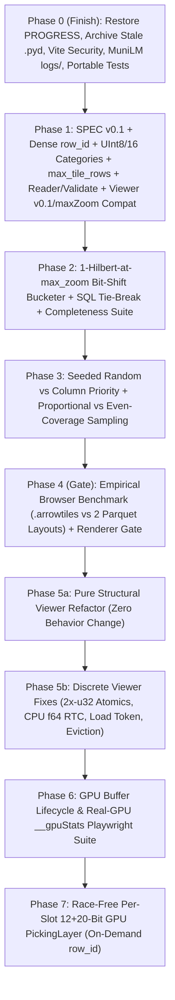

# ArrowTiles + DeepGraph Revival: Merged Consensus Implementation Plan

- **Date:** 2026-11-19
- **Status:** Approved Consensus Plan (`2026-11-19_05_PLAN_all_merged-consensus-revival-plan.md`)
- **Synthesizes:** `HANDOFF_2026-11-19_arrowtiles-revival.RECOVERED.md`, `IMPLEMENTATION_PLAN_2026-11-19_revised.md`, and the 5 verified consensus patches across Gemini + Claude reviews.
- **Repos:**
  - [`duckdb-arrowtiles`](file:///D:/exploratory/duckdb-extension/duckdb-arrowtiles) (writer — branch `revival/2026-11-wip`)
  - [`deepgraph-arrowtiles-sandbox`](file:///D:/exploratory/duckdb-extension/deepgraph-arrowtiles-sandbox) (viewer — branch `revival/2026-11-wip`)

---

## 0. Rules for Every Phase

1. **Handoff guardrails apply in full:**
   - Never read, copy, or adapt code from `deepscatter/`, `deepscatter-source/`, or `Quadfeather` (`CC BY-NC-SA 4.0`).
   - Never edit `LICENSE` files or README license sections.
   - Never run `git push`, delete branches, or rewrite history without explicit owner approval (`⛔`).
   - Large data stays local and untracked. Never delete or overwrite `public/gaia_full.arrowtiles` (31.0 GB), `public/gaia.arrowtiles` (30.3 GB), `public/lmsys_full.arrowtiles` (841 MB), `s3_cache/`, `archive/`, or `research/`.
2. **Single writer & pre-flight check:** Run `git status` in both repos before starting each phase; stop and report any unexpected change.
3. **Append-only progress log:** Never rewrite or truncate [`docs/PROGRESS_2026-11.md`](file:///D:/exploratory/duckdb-extension/duckdb-arrowtiles/docs/PROGRESS_2026-11.md); append one structured entry per phase.
4. **MuniLM `logs/` convention:** Track `logs/README.md` and `logs/YYYY-MM-DD_<seq>_<TYPE>_<scope>_<topic-slug>.md` in [`duckdb-arrowtiles/logs/`](file:///D:/exploratory/duckdb-extension/duckdb-arrowtiles/logs) via surgical `.gitignore` (`logs/*`, `!logs/README.md`, `!logs/20[0-9][0-9]-[0-9][0-9]-[0-9][0-9]_[0-9][0-9]_*.md`), keeping 100% of historic raw transcripts untracked.
5. **Evidence-backed completion:** Every phase stops after passing its acceptance checks and recording commands, counts, and timings in `docs/PROGRESS_2026-11.md`, awaiting owner go-ahead before starting the next phase.

---

## 1. Locked Pre-Execution Decisions & Future Gates

| # | Decision | Status / Resolution | Gate |
| :--- | :--- | :--- | :--- |
| **D1** | Restore `docs/PROGRESS_2026-11.md` from `HEAD` (`8c04c98`) | **Approved & Active** | Phase 0 |
| **D2** | Move stale root `arrowtiles_core.pyd` (`2026-07-22`) to `archive/arrowtiles_core_2026-07-22.pyd` | **Approved & Active** | Phase 0 |
| **D3** | Y-axis convention | **Locked: Top-down** (`y_norm = (max_y - y) / span_y`, matching PMTiles tile row `ty`) + `bounds` block for true aspect ratio | Phase 1 |
| **D4** | Categorical columns | **Locked: Plain integer codes** (`UInt8` up to 256 categories, else `UInt16`) + `stats[col].categories` in metadata; `NULL` masked via Arrow `nullBitmap -> NaN` (never mapped to category `0`); viewer supports 64-color palette + deterministic hue wrap | Phase 1 |
| **D5** | Leaf-tile size (`max_tile_rows`) | **Locked:** Enforced in writer by pushing overflow rows deeper up to `z = 20`; fails with count if a `z = 20` tile still overflows unless `--allow-oversize-leaves` is passed (recording actual `max_tile_rows`) | Phase 1 |
| **D6** | Commit `<20 MB` sample files to Git vs. build/download script | **⛔ Ask owner in Phase 1** | Phase 1 |
| **D7** | Default sampling mode (`proportional` vs. `even_coverage`) | **⛔ Ask owner in Phase 3** after viewing LMSys in both modes | Phase 3 |
| **D8** | Keep PMTiles + Arrow container vs. switch to Parquet | **⛔ Ask owner in Phase 4** after benchmark | Phase 4 |
| **D9** | Compute-only point renderer vs. Dual-Renderer | **⛔ Ask owner before Phase 5a** | Pre-Phase 5 |
| **D10** | Keep per-point ACES+sRGB curve (default) vs. Resolve-pass tone mapping | **⛔ Ask owner with D9** (default: keep per-point curve) | Pre-Phase 5 |

---

## 2. Phase 0 (Finish): Cleanup, Dev-Server Hardening & Portable Tests

1. **Restore `PROGRESS_2026-11.md` (`D1`)** and confirm the 166-line `8c04c98` baseline is intact.
2. **Archive stale root `.pyd` (`D2`)** to `archive/arrowtiles_core_2026-07-22.pyd`.
3. **Bootstrap MuniLM `logs/` tracking (`Patch 5`):** Update `duckdb-arrowtiles/.gitignore` with surgical un-ignore rules; persist our Audit (`03`), Deep Research (`04`), and Merged Consensus Plan (`05`) logs in `duckdb-arrowtiles/logs/` and index `01`–`05` in `logs/README.md` (verifying 0 historic transcript bytes staged).
4. **Harden Vite range server ([`vite.config.ts`](file:///D:/exploratory/duckdb-extension/deepgraph-arrowtiles-sandbox/vite.config.ts)):**
   - Default `server.host` to `'127.0.0.1'`.
   - Wrap `decodeURIComponent` in `try/catch` (`400 Bad Request`).
   - Validate containment *before* `Range` checks via `path.relative(root, resolved)`, returning `403 Forbidden` on `..` or cross-directory escapes.
   - Cap single `Range` reads at `16 MiB`, returning a bounded `206 Partial Content`.
   - Revalidate `stat.size` and `stat.mtimeMs` on cached file descriptors.
5. **Make writer tests portable ([`tests/`](file:///D:/exploratory/duckdb-extension/duckdb-arrowtiles/tests)):**
   - Add `zstd_decompress()` helper (`compression.zstd` on Python $\ge 3.14$, `pyarrow.input_stream(..., compression="zstd")` fallback on Python 3.10–3.13).
   - Replace hardcoded `D:\exploratory\...` paths with relative workspace-sibling fixtures + env overrides that `pytest.skip` cleanly when local datasets are absent.
   - Assert in `conftest.py` that `Path(arrowtiles_core.__file__).resolve()` resides inside `.venv` (rejecting repo-root or global system `site-packages` builds).

**Acceptance Checks:** Both trees clean after commit; `pytest` passes (`6 passed, 1 skipped` or better); `/..%2F..%2Fduckdb-arrowtiles%2Ftest.arrowtiles` returns `403`; `Range: bytes=0-` on a multi-GB file returns a bounded 16 MiB `206`; `npx tsc --noEmit` passes.

---

## 3. Phase 1: `SPEC.md` v0.1, Single-Pass Format Updates, Reader/Validator & Viewer Compat

### 3.1 `duckdb-arrowtiles/docs/SPEC.md` ($\le 3$ pages)
- **Identity:** PMTiles v3 (`TileType = Unknown`, `TileCompression = Zstd`, `Clustered = true`, `min_zoom = 0`, accurate `max_zoom`); metadata `"format": "arrowtiles"`, `"version": "0.1"` (reject unknown major versions).
- **Tile Payload:** Base64 `[SchemaMessage]` (no EOS) in `arrow_schema`; tiles hold Zstd-compressed `[RecordBatch][EOS]`; no `DictionaryBatch` messages (`D4`).
- **Coordinates:** `bounds: {min_x, max_x, min_y, max_y}`; `x_norm = (x - min_x) / span_x`, **top-down `y_norm = (max_y - y) / span_y`** (`D3`); `z: UInt8`, `x_u16`, `y_u16`.
- **Row Identity & Completeness (`Patch 3`):** Required unique `row_id: UInt64`; finite-coord rows appear in **exactly one** tile; metadata records `total_rows`, `dropped_rows`, and `max_tile_rows` (`D5`).
- **Priority & Sampling:** `priority` (`random` with `seed` vs. `column` with `order`); `sampling` (`even_coverage` vs. `proportional`); priority contract holds **per grid cell** at $Z \le 6$ in `even_coverage` and **per tile** otherwise.
- **Stats, View Hints & Reserved Identifiers:** Finite-only `stats` (`min`, `max`, `null_count`, `categories`), reserved `tile_stats`, optional `view` block (`colorField`, `sizeField`, `colorScale`, `preserveAspect`), reserved columns (`row_id`, `x_u16`, `y_u16`, `z`, `__at_*`) and metadata keys.

### 3.2 Writer Package & Safety Overhaul (`arrowtiles/` + `lib.rs`)
- Restructure `arrowtiles.py` into `arrowtiles/` (`builder.py`, `reader.py`, `validator.py`, `__init__.py`, `__main__.py`) + root `pyproject.toml` (`module-name = "arrowtiles_core"`, installing into `.venv` and never repo root).
- **Dense Deterministic `row_id` (`Patch 3`):** Compute contiguous per-file row offsets from `parquet_file_metadata` over a sorted file list + `read_parquet(<files>, filename=true, file_row_number=true)` (`file_base_offset + file_row_number`, dense in `0 .. N-1`, `< 5 ms`, safe within JS `2^53`), or `--id-col`.
- Filter `isfinite(x) AND isfinite(y)` (recording `dropped_rows`); guard all `MIN`/`MAX` with `FILTER (WHERE isfinite(col))`; `json.dumps(..., allow_nan=False)`; error on invalid/reserved `custom_metadata` keys in `lib.rs`.
- Use `__at_x_norm`, `__at_y_norm`, drop raw source `x`/`y` by default (`--keep-source-xy` opt-in), and fail clearly on reserved input column names (`z`, `x_u16`, `y_u16`, `row_id`).
- Cast categoricals to `UInt8` ($\le 256$) or `UInt16` codes in sorted category order (`D4`).
- Enforce `max_tile_rows` at leaf levels by pushing overflow up to `z = 20` (`D5`).
- Set `.min_zoom(0).max_zoom(...)` on `PmTilesWriter`, assert strictly increasing `tid`, write to `<output>.tmp` + rename, fix `finalize()` `.unwrap()`, remove `allow_unsigned_extensions`, escape `'` in paths, close DuckDB in `finally`, set Pass 1 `.set_max_row_group_size(100_000)` + `zstd(1)`, and persist `--resume` `manifest.json`.

### 3.3 Reference Reader (`arrowtiles/reader.py`) & Validator (`python -m arrowtiles validate`)
- `ArrowTilesReader`: lists tiles, reads metadata, decodes any `(z, x, y)` tile to `pyarrow.Table` with `x_decoded`/`y_decoded` in source units (and helper to map categorical integer codes back to `categories`).
- `validate`: checks header, `format`/`version` (warning, not error, on legacy v0.0 files), schema + all tiles parse, `sum(tile_rows) == total_rows`, `row_id` uniqueness, and `<= max_tile_rows`.

### 3.4 Viewer v0.1 Compatibility & Fast Safety Fixes (`Patches 2 & 4a`)
- Read v0.1 `format`/`version`, `bounds` (aspect ratio), `view` block, top-down generic `y`, and `UInt8`/`UInt16` metadata `categories` (keeping console-warn fallback for v0.0 files).
- **Header `maxZoom` Plumbing (`Patch 2`):** Read `header.maxZoom` from PMTiles and replace hardcoded `14` at [`main.ts:768`](file:///D:/exploratory/duckdb-extension/deepgraph-arrowtiles-sandbox/src/main.ts#L768) so `z = 15..20` overflow tiles under `D5` are visible *(temporary `f32` grid-snap past `z ≈ 13` accepted until Phase 5b)*.
- **Arrow Nulls & Categorical `NaN` (`Patch 4a`):** Apply `nullBitmap -> NaN` in `pmtiles.worker.ts` (and `buf.fill(NaN)` for missing cols); guard `!(val == val)` *before* categorical palette lookup in `ComputeRasterizer.ts:401-406` (and expand `paletteBuf` from `% 10u` to 64 distinct colors + wrap note when `dictLen > 64`).
- Cap non-spatial quadtree depth at `min(z, 2)` (`F-01`) and reset sticky `flipY` when exiting HR Diagram (`F-06`).
- Build `<20 MB` Gaia, LMSys, and edge-case samples (`⛔ D6` before committing samples).

---

## 4. Phase 2: Reproducible Builds & Completeness Suite (`Patch 4b`)

1. Append `, row_id ASC` tie-breaker to Pass 1 and Pass 2 `ORDER BY` queries.
2. **Single-Hilbert Bit-Shift 2-Stage Bucketer (`Patch 4b`):**
   - **Stage A (Parallel, Pure Math):** Compute normalized `(x, y)` and **one** Hilbert index `h_max = fast_hilbert::xy2h(ix_max, iy_max, effective_max_zoom)` per row at `effective_max_zoom`.
   - **Stage B (Sequential, Priority Order):** Derive every zoom level `z`'s Hilbert index via bit shift `h_z = h_max >> (2 * (effective_max_zoom - z))` (`tid_z = PYRAMID_OFFSET[z] + h_z`) and claim cells/capacities in plain `Vec<u64>`, `Vec<u32>`, and `HashMap<u64, u32>` with saturating counts and zero atomics.
   - Add a dedicated unit test verifying `PYRAMID_OFFSET[z] + (h_max >> (2 * (max_z - z))) == TileId::from(TileCoord::new(z, ix_z, iy_z))` across all `z = 0..=20`.
3. Benchmark Pass 1 throughput delta on a **100M-row Gaia subset** (`⛔` pause if `> 20%` slower).
4. Run `tests/test_determinism_and_completeness.py` verifying: (a) byte-identical SHA-256 rebuilds (unique & tied priorities), (b) `sum(rows) == input - dropped`, (c) unique `row_id`, and (d) per-cell ($Z \le 6$ `even_coverage`) / per-tile priority contract.

---

## 5. Phase 3: Explicit Priority & Sampling

1. Remove `sort_col="abs_m"` default; default to `hash(row_id, seed)` (`{"kind": "random", "seed": N}`).
2. Add explicit `--preset gaia` (Hammer projection, `phot_g_mean_mag ASC`—accepting both `phot_g_mean_mag` and legacy `abs_m` in viewer—and `even_coverage`).
3. Pass `tile_capacity` and `sampling` (`even_coverage` vs. `proportional`) explicitly to `run_bucketer` (`max_capacity = 100_000` means `100,000`).
4. Display active `priority` and `sampling` in viewer HUD; `⛔ D7` owner views LMSys in both modes and picks default.

---

## 6. Phase 4: Parquet Benchmark (`⛔ D8`) + Pre-Phase-5 Renderer Gate (`⛔ D9, D10`)

- Benchmark `.arrowtiles` vs. **two** sorted Parquet layouts ((1) 1 row group/tile + index, (2) larger row groups + Parquet Page Index) across samples, full LMSys (3-of-38 projection + full schema), and $\ge 100\text{M}$ Gaia rows (5 runs each, median + P95: metadata bytes, TTFF, deep-zoom load, worker decode ms, peak JS/WASM RAM) in `docs/BENCHMARK_parquet_vs_arrowtiles.md`.
- Pause at `⛔ D8` (container choice) and `⛔ D9 / D10` (Compute-Only vs. Dual-Renderer, and per-point vs. Resolve tone mapping).

---

## 7. Phase 5a (Pure Refactor) & Phase 5b (Discrete Viewer Fixes)

- **Phase 5a (Zero Behavior Change):** Split `src/main.ts` (`< 150` lines) into `DatasetSession`, `ViewState`, `RenderLoop`, `ControlsPanel`, and `ViewerLayer`; isolate Three.js internals; declare `fflate`, add `typecheck`, and (`⛔` after confirmation) remove unused deps (`@sentry/*`, `gl-matrix`, `stats.js`) and dead `ui.ts`, `counter.ts`, `compute_test.mjs`. Verify identical before/after behavior on both samples.
- **Phase 5b (Discrete Fixes, Each Individually Checked):**
  1. Widen `accumBuffer` to `2 × u32` (`8 B/px`, checking `maxStorageBufferBindingSize` at 5K), separating `valSum` and `wSum | lineHits` in Modes 2 & 4 and keeping per-point curve unless `D10` changes it.
  2. CPU `Float64` Relative-to-Center tile offsets uploaded as `f32` (`F-07`) + Mode 4 `cpy < screenHeight` guard.
  3. Monotonic load-generation token in `DatasetSession` + single `PMTiles` instance per load.
  4. Unload tiles before recycling buffers in `setRequestedColumns` (`F-09`).
  5. Retry backoff + negative cache on failed tiles; complete `destroy()` / `ComputeRasterizer.dispose()` cleanup; clamp `zoomTUniform` to `[0, 1]`.
  6. If `D9 = Option 1`, move 2s axis transitions into `ComputeRasterizer` and retire `Scatterplot` point meshes.

---

## 8. Phase 6: Real GPU-Memory Test (`__gpuStats`)

- Instrument `GPUDevice.prototype.createBuffer` / `GPUBuffer.prototype.destroy` -> `window.__gpuStats` and HUD `liveBytes`; implement dynamic buffer lifecycle per `D9` (never leaving 0-length arrays on live attributes under Option 2, and preserving shared `position`/`uv`).
- Run `tests/gpu-vram-lifecycle.spec.ts` on headed real-GPU Chrome (`channel: 'chrome'`; `⛔` ask before any `playwright install`): verify $\ge 20$ tiles & $> 0$ points, run deep-zoom eviction trajectory (`> maxCacheSize`), verify `liveBytes` plateaus, run 5 dataset swaps back to baseline, and confirm negative control fails when eviction/disposal is disabled.

---

## 9. Phase 7: Race-Free Per-Slot GPU `PickingLayer` (`Patch 1`)

- On click (`< 4 px` cursor movement), dispatch a $9 \times 9\text{ px}$ cursor-window compute pass writing to a **1 KB `slotBestHit: array<atomic<u32>, 256>`** buffer (1 word per slot, `0 B` per-frame overhead).
- Each candidate packs **12-bit distance in sixteenths of a pixel + 20-bit row index** (`(dist16th_u12 << 20) | rawRowIdx_u20`, supporting up to `1,048,575` rows/tile; dynamically falling back if `--allow-oversize-leaves` exceeds $2^{20}$), un-scrambling the 2,048-row bijection and matching shader hash jitter, via a **single race-free `atomicMin`** per slot.
- CPU reads back 1 KB, selects the best hit across active slots **breaking distance ties by coarser zoom level `z` first** (higher global priority) and `rawRowIdx` second, then fetches/decodes `row_id` + full row attributes from that single tile on demand (`0 MB` idle worker RAM)—verified against `arrowtiles.reader` by `row_id` on both samples.
