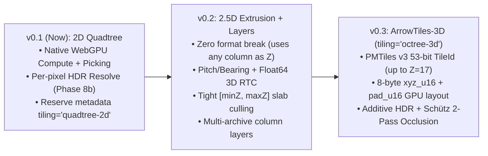

# Deep Research & Comprehensive Architectural Review: 2.5D Extrusion & Volumetric Octree ArrowTiles (`v0.2` → `v0.3`)

> [!NOTE]
> **Scope & Guardrails:** This report synthesizes a primary-source code audit (`/comprehensive-review-full-review`) of your June 2026 2.5D repository and octree design archives alongside an external landscape & algorithmic review (`/deep-research`). All repository inspections were conducted strictly **read-only and 100% CPU-only** (zero interference with **Deepgraph Coder**'s active `Phase 8b` + `D12b` work or your RTX 5090 ML training job, and zero contact with restricted `deepscatter` / `Quadfeather` folders).

---

## 1. Executive Verdict

1. **You pushed much harder on both 2.5D and Octrees in June 2026 than a casual sketch:**
   - **2.5D was built, working, and shipped** in [deepgraph-webgpu](file:///d:/exploratory/duckdb-extension/deepgraph-webgpu/README.md) (`kai-erlenbusch/deepgraph`), using flat 2D quadtree Arrow tiles + GPU `layerSpacingUniform` Z-extrusion + tilted orbital perspective + tall-prism (`Box3`) frustum culling.
   - **Octrees were deeply researched across four artifacts** — the June 5–6 architecture sessions ([conversation_history_2026-06-05.md](file:///d:/exploratory/duckdb-extension/deepgraph-arrowtiles-sandbox/logs/old/conversation_history_2026-06-05.md)), a dedicated [3d-implementation-plan.md](file:///d:/exploratory/duckdb-extension/deepgraph-arrowtiles-sandbox/logs/old/3d-implementation-plan.md), a C++20 library audit of `attcs/OrthoTree` ([octree-review.md](file:///d:/exploratory/duckdb-extension/deepgraph-arrowtiles-sandbox/logs/old/octree-review.md) / `Octree_Study/`), and the [Entwine EPT C++ review](file:///d:/exploratory/duckdb-extension/duckdb-arrowtiles/logs/old/2026-06-29_entwine_arrowtiles_architecture_review.md) — before you wisely pivoted to solving the single-file `.arrowtiles` container and zero-atomic Rust bucketer in 2D first.
2. **Both tracks remain high-leverage, in a clear two-step sequence after `v0.1`:**
   - **Stage 1 (`v0.2` — 2.5D Pitch/Bearing Extrusion):** Delivers ~85% of interactive 3D value at ~15% of the engineering cost, with **zero changes to the `.arrowtiles` `v0.1` file format**. Any existing numeric column (`phot_g_mean_mag`, `parallax`, `num_of_tokens`, elevation, fare, timestamp) can lift points in real time on our new native WebGPU `ComputeRasterizer`.
   - **Stage 2 (`v0.3` — `tiling: "octree-3d"` ArrowTiles-3D):** Genuine greenfield ecosystem opportunity — **"COPC for any Apache Arrow table."** Neither COPC/EPT (locked to fixed LiDAR schemas) nor OGC 3D Tiles 1.1 (glTF/mesh-centric with multi-file or complex subtree bitstreams) provides a single-file, HTTP-Range-native, schema-arbitrary Arrow octree with deterministic multiscale priority sampling.
3. **Reserving `"tiling": "quadtree-2d"` in `SPEC.md` right now (Claude's Amendment E) is the exact right forward-compatibility hook** — with **one critical backwards-compatibility rule** to verify when **Deepgraph Coder** finishes:
   - Readers **must treat omitted `"tiling"` as `"quadtree-2d"`** (so existing `v0.1` sample/benchmark archives remain valid) while **rejecting unknown explicit strings** (so a `v0.1` 2D viewer fails fast with a clear message if handed a future `"tiling": "octree-3d"` archive).

---

## 2. Archaeological Code Review of Our June 2026 Work (`/comprehensive-review-full-review`)

### 2.1 Audit of the Working June 2026 `deepgraph-webgpu` 2.5D Engine

We audited all four source files in `d:\exploratory\duckdb-extension\deepgraph-webgpu\src`:
- [main.ts](file:///d:/exploratory/duckdb-extension/deepgraph-webgpu/src/main.ts) (`591` lines — Three.js TSL `InstancedBufferGeometry` + `layerSpacingUniform`)
- [Renderer.ts](file:///d:/exploratory/duckdb-extension/deepgraph-webgpu/src/core/Renderer.ts) (`133` lines — `PerspectiveCamera(45°)` + `OrbitControls` + `set2DMode`)
- [TileManager.ts](file:///d:/exploratory/duckdb-extension/deepgraph-webgpu/src/data/TileManager.ts) (`283` lines — `Box3` frustum traversal + distance LOD)
- [ArrowWorker.ts](file:///d:/exploratory/duckdb-extension/deepgraph-webgpu/src/data/ArrowWorker.ts) (`117` lines — `.geom.arrow` + `.semantic.arrow` two-stage worker)

#### What Worked Well (Keep the Design Concepts)
1. **Zero-Cost 2D ↔ 2.5D Extrusion Multiplier ([main.ts:89-90, 203-204](file:///d:/exploratory/duckdb-extension/deepgraph-webgpu/src/main.ts#L203-L204)):**
   `finalZ = offset3DAttr.z * layerSpacingUniform` (`0.0` flat → `1.0` extruded) allowed instantaneous/animated transitions between a strict top-down 2D map and a tilted 3D topographic relief without reloading a single tile.
2. **2-Stage Geometry-First / Semantic-Second Streaming ([ArrowWorker.ts:17-68](file:///d:/exploratory/duckdb-extension/deepgraph-webgpu/src/data/ArrowWorker.ts#L17-L68)):**
   Notably, your June `ArrowWorker.ts` *already* prototyped split `.geom.arrow` and `.semantic.arrow` streams — the direct ancestor of our `v0.2` multi-archive column-group `"layers"` (`D8`)!
3. **Perspective Screen-Space LOD Metric ([TileManager.ts:195-200](file:///d:/exploratory/duckdb-extension/deepgraph-webgpu/src/data/TileManager.ts#L195-L200)):**
   Switching from uniform camera `zoom` to per-tile `dist < nodeSize * 1.5` naturally loaded finer tiles near the foreground of a tilted view and coarser tiles toward the horizon.

#### Five Architectural Bugs Found in the June 2.5D Code (Must Not Repeat in `v0.2`)

| Severity | Location in `deepgraph-webgpu` | Flaw Identified in Audit | Clean `v0.2` Solution on Current Compute Engine |
| :---: | :--- | :--- | :--- |
| **P0** | [TileNode](file:///d:/exploratory/duckdb-extension/deepgraph-webgpu/src/data/TileManager.ts#L39-L42) (`Box3(minX, minY, -1000..+1000)`) | **Horizon Frustum Explosion:** Treating every tile as an `[-1000, +1000]` tall column meant that pitching the camera past `~55°` caused almost *every* tile toward the horizon to intersect the frustum, exhausting the tile cache on empty sky above/below the data slab. | Bound every tile's 3D AABB tightly by `[zRangeMin * elevationScale, zRangeMax * elevationScale]` from `metadata.stats[zField]` (`min`/`max`) — shrinks prism height `50×–500×`. |
| **P1** | [Renderer.ts:65](file:///d:/exploratory/duckdb-extension/deepgraph-webgpu/src/core/Renderer.ts#L65) (`ray.intersectPlane(Z=0)`) | **Parallax Drift on Wheel Zoom:** Wheel-zoom always intersected the `Z = 0` ground plane, so zooming while pointing at an elevated `Z > 0` peak zoomed *behind* the cluster, sliding the target off the cursor. | Query the depth of the point under the cursor (via our `0.1 ms` `PickingLayer` or active `targetZ`) and zoom along the cursor ray toward that exact 3D anchor. |
| **P1** | [Renderer.ts:70](file:///d:/exploratory/duckdb-extension/deepgraph-webgpu/src/core/Renderer.ts#L70) (`if (currentDist < 0.2) return`) | **Hard `Float32` Precision Wall:** Deep zoom had to be hard-blocked at `dist = 0.2` to avoid `Float32` vertex jitter. | Already solved in `v0.1` (`Phase 5b`): extend our CPU `Float64` Relative-to-Center (`RTC`) offset `(rtcBaseX, rtcBaseY, rtcBaseZ)` to 3D before multiplying by the `3×4` view-projection matrix. |
| **P1** | [main.ts:120-124](file:///d:/exploratory/duckdb-extension/deepgraph-webgpu/src/main.ts#L120-L124) (`One` / `OneMinusSrcAlpha`, `depthWrite: false`) | **Order-Dependent Alpha Sorting Artifacts:** Standard premultiplied `Over` blending without Z-sorting renders whichever tile happened to be added to `tileMeshes` last *in front of* closer tiles when tilted. | Use **order-independent** linear HDR / log-density accumulation (`D10` + `Phase 8b`) for emissive/density modes, plus **Schütz 2-Pass `atomicMin` Depth + Shell Accumulation** (Section 4.2) when true front-surface occlusion is desired. |
| **P2** | [TileManager.ts:192, 212](file:///d:/exploratory/duckdb-extension/deepgraph-webgpu/src/data/TileManager.ts#L192-L212) | **Dead `allIntersectingChildrenLoaded` + Unbounded Queue:** `allIntersectingChildrenLoaded` was computed and thrown away, and `getVisibleTiles` had no `maxCacheSize` priority-score cap during rapid tilt-pans. | Reuse `PMTilesClient.getVisibleTiles`'s existing priority-scored budget (`maxCacheSize - 10`) with screen-space geometric error `nodeWorldWidth / distToTileAABB`. |

---

### 2.2 Audit of the June 2026 Octree Investigations

Your historical octree research spanned three distinct architectural spikes:
1. **[octree-review.md](file:///d:/exploratory/duckdb-extension/deepgraph-arrowtiles-sandbox/logs/old/octree-review.md) (`attcs/OrthoTree` in `Octree_Study/`):** Correctly rejected in-memory C++ `StaticLinearOrthoTreeCore` (`std::vector<EntityID>` OOMs at $10^9$ rows) while extracting fast 3D Morton bit-interleaving (`detail/si_mortongrid.h`) and pointer-free linear integer node IDs.
2. **[2026-06-29_entwine_arrowtiles_architecture_review.md](file:///d:/exploratory/duckdb-extension/duckdb-arrowtiles/logs/old/2026-06-29_entwine_arrowtiles_architecture_review.md):** Reverse-engineered Entwine's `chunk.cpp` (`256³` voxel occupancy pushdown) and proved why **PMTiles + Arrow IPC** beats EPT's hundreds of thousands of small `.laz`/`.bin` files + `ept-hierarchy/*.json` manifests.
3. **[3d-implementation-plan.md](file:///d:/exploratory/duckdb-extension/deepgraph-arrowtiles-sandbox/logs/old/3d-implementation-plan.md):** Proposed a separate C++ DuckDB extension (`duckdb-deepgraph-3d`) packing `[X_f32, Y_f32, Z_f32, RGBA_u32]` (`16 B/pt`) under `z/x/y/k` URLs.
   - **What our November `v0.1` revival changed:** We no longer need a fragile C++ DuckDB internal extension or multi-file `z/x/y/k` URLs! Our PyO3/Rust `run_bucketer` (`arrowtiles-engine/src/lib.rs`) + `SplitMix64` deterministic priority + PMTiles v3 64-bit `TileId` index already solves 85% of what `3d-implementation-plan.md` called *"The Hard Part."*

---

## 3. Competitive Landscape & Market White Space (`/deep-research`)

| System / Format | Spatial Hierarchy | Container & HTTP Transport | Attribute Schema | WebGPU Compute Ready? | Key Limitation for General Tabular / Scientific Data |
| :--- | :---: | :--- | :--- | :---: | :--- |
| **COPC 1.0** (`.copc.laz`) | 3D Octree | Single file (LAZ 1.4 + VLR byte-range index) | Fixed LAS 1.4 point record + awkward ExtraBytes | Partial (CPU/WASM LAZ decode bottleneck) | Arithmetic LAZ coding is slow to decode in browsers and hostile to arbitrary Arrow columns/categories. |
| **Entwine (EPT)** | 3D Octree | Multi-file (`ept.json` + `ept-data/*.laz` + `ept-hierarchy/*.json`) | LAS/LAZ or fixed binary | Partial | S3 small-file explosion + multi-RTT hierarchy traversal. |
| **OGC 3D Tiles 1.1** (Implicit Tiling) | Quadtree or Octree | `.3tz` zip or multi-file `.subtree` bitstreams + glTF 2.0 | `EXT_structural_metadata` inside glTF buffers | Heavy glTF scene overhead | Built for 3D textured meshes/buildings; complex subtree availability bitstreams and glTF wrapper bloat for pure point tables. |
| **Potree 2.0 / Potree-Next** (Schütz, TU Wien) | 3D Octree (`hierarchy.bin` + `octree.bin`) | 2–3 flat files (`metadata.json`, `hierarchy.bin`, `octree.bin`) | LiDAR-oriented fixed attributes | **Yes** (`Potree-Next` is SOTA WebGPU compute) | Best-in-class 3D LiDAR renderer, but custom binary layout — no DuckDB/Arrow zero-copy ecosystem or arbitrary chart/axis encoding. |
| **`visgl/loaders.gl`** (`@loaders.gl/tiles` + `3d-tiles` + `arrow` + `pmtiles`) | `Tileset3D` SSE traversal (`ADD` & `REPLACE`) | Multi-loader runtime (consumes 3D Tiles, I3S, Potree, COPC, 2D PMTiles, Arrow) | Arrow in-memory (`@loaders.gl/arrow`), format-dependent on disk | WebGL2 / WebGPU via `deck.gl` (`luma.gl`) | Loader/traversal SDK rather than a single-file format — has Arrow, PMTiles, and 3D Tiles loaders separately, **but no unified single-file Arrow octree/quadtree archive** (making an `ArrowTilesLoader` plugin a major distribution opportunity!). |
| **`VoxelHex`** (`Ministry-of-Voxel-Affairs`, Rust + `wgpu` WGSL) | Sparse 64-Tree ($4^3$ children/node) / VoxelBricks | GPU storage-buffer voxel bricks + proximity chunk streaming | Voxel material ID / occupancy bitmask (`u64` `ChildMask`) | **Yes** (`wgpu` WGSL DDA raymarching + path tracing) | Built for discretized voxel game worlds (raymarches grids rather than preserving continuous `row_id` tabular rows), though its **`u64` `ChildMask` + `countOneBits` empty-space skipping** is a great fit for `v0.3` octree traversal. |
| **GeoParquet / DuckDB HTTPFS** | Row-group Hilbert / bbox | Single/partitioned `.parquet` | Arbitrary tabular | No multiscale LOD pyramid | Proven in our Phase 4 WAN benchmark (`50 ms` RTT): lacks fine multiscale spatial tiles + metadata overhead costs `1.7×–2.6×` latency. |
| **ArrowTiles (`v0.1` → `v0.3`)** | `quadtree-2d` (`v0.1`) / `octree-3d` (`v0.3`) | **Single `.arrowtiles` (valid PMTiles v3 + Zstd Arrow IPC)** | **Arbitrary Arrow schema + categorical dicts + column layers** | **Native zero-copy `TypedArray` → `GPUBuffer`** | **Unique white space:** *"COPC + PMTiles for any DuckDB/Arrow table."* |

### 3.1 Specific Lessons Extracted from `loaders.gl` and `VoxelHex`

1. **From `visgl/loaders.gl` (`@loaders.gl/tiles` `Tileset3D`):**
   - **Unified Screen-Space Error (`maximumScreenSpaceError` in pixels):** `Tileset3D` drives both `ADD` (additive point-cloud LOD — our exact model!) and `REPLACE` refinement from a single pixel-error formula:
     $$\text{SSE}_{\text{px}} = \frac{\text{geometricError} \cdot \text{screenHeight}}{2 \cdot d \cdot \tan(\text{fov} / 2)}$$
     Adopting this exact `SSE_px` metric in `v0.2` (2.5D) and `v0.3` (`octree-3d`) reduces seamlessly to our 2D `floor(log2(zoom)) + detailOffset` rule when `pitch = 0°`, unifying 2D, 2.5D, and 3D tile selection under one mathematical knob.
   - **Ecosystem Multiplier (Apache-2.0 Synergy):** Because `D12b` moves ArrowTiles to `Apache-2.0` (matching `loaders.gl`'s permissive `MIT` ecosystem), a lightweight `@loaders.gl` / `deck.gl` adapter later would allow existing `deck.gl`, `Kepler.gl`, and `SQLRooms` apps to mount `.arrowtiles` archives directly.
2. **From `Ministry-of-Voxel-Affairs/VoxelHex` (`shocovox` lineage, Rust + `wgpu`):**
   - **Why its renderer differs:** `VoxelHex` uses *backward* per-pixel DDA raymarching through discretized $4^3$ voxel bricks (ideal for solid voxel games/lighting, whereas Deepgraph needs *forward* compute point splatting to preserve exact sub-voxel coordinates, continuous 2s axis transitions, and per-point `row_id` picking).
   - **What to borrow for `v0.3`:** Its **$4^3 = 64$-child `u64` occupancy bitmask (`ChildMask` + WGSL/CPU `countOneBits`)**. Two octree levels ($8 \times 8 = 64$ grandchildren) pack into **one 64-bit integer (`8 bytes`)**, letting traversal leap across empty 3D space in $O(1)$ without probing empty octants.

> [!IMPORTANT]
> **Strategic Takeaway:** In 3D scientific, ML, and geospatial analytics — **3D UMAP/PacMAP embeddings**, **Gaia DR3/DR4 3D Cartesian parsec space**, **N-body cosmology (`Quijote` / `IllustrisTNG`)**, **3D spatial transcriptomics / single-cell tissue volumes**, and **rich-attribute LiDAR** — researchers currently live in DuckDB/Polars/PyArrow/Parquet, yet have **zero** single-file browser-streamable octree formats that preserve arbitrary Arrow columns.

---

## 4. Stage 1 Technical Blueprint (`v0.2`): 2.5D Pitch/Bearing on Native WebGPU

### 4.1 Zero Format Break & Clean Public API Surface
2.5D requires **zero changes** to `.arrowtiles` `v0.1` archives:
- **Encoding:** Add optional `z?: string | AxisChannelEncoding | null` (or `elevation?: { field: string; domain?: [number, number]; scale?: number }`) to `DeepgraphEncoding`. Setting `z: null` (or `scale: 0`) smoothly animates `elevationScale` back to `0.0` over our existing 2-second WGSL transition!
- **Viewport (`MapLibre` / `deck.gl` conventions):** Extend `ViewportState` optionally with `pitch?: number` (`0°..75°`, default `0°`) and `bearing?: number` (`-180°..180°`, default `0°`). When `pitch === 0 && bearing === 0`, projection reduces **exact-identically** to today's fast 2D orthographic path.

### 4.2 Camera, Culling & WGSL Projection (`ComputeRasterizer` + `PickingLayer`)
1. **3D `Float64` Relative-to-Center (`RTC`) Projection:**
   Keep camera target `(targetX, targetY, targetZ)` in CPU `Float64`. For each tile slot, precompute `rtcBaseX/Y` in `Float64` exactly as today, compute `relZ = map_linear(zBuf[i], zDomMin, zDomMax, zRangeMin, zRangeMax) * elevationScale - targetZ`, and multiply `(relX, relY, relZ, 1.0)` by a single `4×4` tilted view-projection matrix in WGSL (shared identically between `ComputeRasterizer` and `PickingLayer`!).
2. **Tight Slab-Box Frustum Culling (`PMTilesClient.getVisibleTiles`):**
   Each quadtree tile $(z, x, y)$ becomes a tight 3D AABB `[minX, maxX] × [minY, maxY] × [minZ_scaled, maxZ_scaled]` tested against the 6 frustum planes, ordered by screen-space geometric error $\text{SSE} = \frac{\text{tileWorldWidth}}{\max(\text{distToAABB}, \epsilon)}$.
3. **Two Rendering Modes in `ComputeRasterizer`:**
   - **Additive / Log-Density (`Modes 0, 1, 3`):** Commutative & associative — works **out of the box** in 2.5D with perspective point sizing (`diameterPx *= focalDist / clipPos.w`)!
   - **Occluded Surface Mode (Schütz 2-Pass WGSL Compute, Optional):** Standard WebGPU lacks universal `u64` atomics, so `Potree-Next`'s 64-bit `atomicMin((depth << 32) | rgba)` requires an extension. Instead, Schütz et al.'s **Two-Pass WGSL algorithm** works on **100% baseline WebGPU** using only `4 B/px` extra (`~8 MB` at 1080p):
     - **Pass 1 (`depthBuffer: array<atomic<u32>>`):** Clear to `0x7F7FFFFFu`; each visible point writes `atomicMin(&depthBuffer[idx], bitcast<u32>(positiveClipDepth))`.
     - **Pass 2 (Existing `accumBuffer: array<atomic<u32>>`, `8 B/px`):** Accept only points within a thin `1%` front-surface shell (`positiveClipDepth <= bitcast<f32>(minDepth) * 1.01`) and accumulate anti-aliased RGB + weight exactly like our existing Mode 1/2 resolve!

---

## 5. Stage 2 Technical Blueprint (`v0.3`): Volumetric `octree-3d` Inside `.arrowtiles`

### 5.1 Verified PMTiles v3 `TileId` Capacity (`53-Bit` JS Ceiling = Depth `Z = 17`)
We inspected `readVarint` and `findTile` directly in [node_modules/pmtiles/src/index.ts](file:///d:/exploratory/duckdb-extension/deepgraph-arrowtiles-sandbox/node_modules/pmtiles/src/index.ts#L10-L56) (`pmtiles@4.4.1`):
- PMTiles v3 stores `tile_id` on disk as an unsigned LEB128 varint (up to 64 bits), **and `pmtiles-js` decodes it into a standard JavaScript `number` (`IEEE-754` 53-bit integer, `Number.MAX_SAFE_INTEGER = 9,007,199,254,740,991`)** without calling `zxyToTileId` inside `getDirectory` or `findTile`!
- Define the level-order 3D octree `TileId` bijection:
  $$\text{TileId}_{3\text{D}}(z, x, y, k) = \frac{8^z - 1}{7} + \text{SFC}_{3\text{D}}(z, x, y, k)$$
- **Exact maximum octree depth in unmodified `pmtiles-js`:**
  $$\sum_{z=0}^{17} 8^z = \frac{8^{18} - 1}{7} = 2,573,485,501,354,569 < 2^{53} - 1 = 9,007,199,254,740,991$$
  At $z = 17$, each axis has $2^{17} = 131,072$ octants, and paired with intra-tile `u16` (`65,536` steps), effective coordinate precision is **$2^{33} \approx 8.59 \times 10^9$ steps per axis** (`~11 microns` across a `100 km` city scan, or `~0.00001 parsecs` across the Milky Way!) — while remaining a **100% valid PMTiles v3 file** whose header, root directory, leaf directories, Zstd payloads, and CDN Range caching work untouched!
- **3D Hilbert vs. 3D Morton (`Z-order`):** Use **3D Hilbert** (`fast_hilbert` in Rust supports $N$-D, plus a 30-line lookup table in TS) so spatially adjacent 3D octants stay contiguous in `tile_id` space, preserving PMTiles directory `runLength` compression and coalesced byte-range reads.

### 5.2 What Reuses Verbatim vs. What Changes in `v0.3`

| Component | Reuse % | Exact Delta from `v0.1` (`quadtree-2d`) to `v0.3` (`octree-3d`) |
| :--- | :---: | :--- |
| **Container & Metadata (`SPEC.md`)** | **95%** | Set `"tiling": "octree-3d"`, add `"min_z"` / `"max_z"` to `"bounds"`, and store `[x_u16, y_u16, z_u16]` (`6 B` Arrow / `8 B` `vec2<u32>` GPU buffer with `pad_u16`). |
| **Rust Two-Stage Bucketer (`lib.rs`)** | **85%** | Stage 1 partitions into $8^2 = 64$ or $8^3 = 512$ macro octants; Stage 2 walks `z = 0..max_zoom` across 8 children instead of 4; `SplitMix64(row_id, seed)` priority, `tile_capacity`, `max_tile_rows`, categorical dictionary encoding, and Zstd schema-stripped Arrow IPC stay **100% identical**. (For `even_coverage`, use a $32^3 = 32,768$ coarse `u32` array = `128 KB`, L2-cache resident!) |
| **Worker Pool & Column Layers (`PMTilesClient`)** | **90%** | Bypass `pmtiles.getZxy(z,x,y)` with a thin `getOctreeTile(z, x, y, k)` wrapper calling `findTile(directory, octreeTileId(z, x, y, k))` on the exact same `SharedPromiseCache` + `FastFetchSource`. |
| **WebGPU `ComputeRasterizer` & `PickingLayer`** | **75%** | Unpack `xyz_u16` (`vec2<u32>`), run 6-DoF camera frustum + `SSE` traversal, and support both **Volumetric Emission/HDR** (galaxies, cosmology, embeddings) and **Schütz 2-Pass Surface Occlusion** (LiDAR, dense CAD/scans). |

---

## 6. Honest Engineering Caveats & Domain Pitfalls to Keep in Mind

1. **Why 2.5D Should Still Ship Before Octrees:**
   Many "3D" tabular views are actually **anisotropic slabs** (`(x, y)` map + scalar metric `z`). An octree wastes subdivisions when `Z` is dynamically swapped by the user in a dropdown (`z = fare`, then `z = tip`, then `z = trip_duration`) — because an octree bakes one fixed `Z` coordinate into the spatial hierarchy on disk, whereas **2.5D lets the user re-bind `Z` dynamically to *any* column in the archive at 60 FPS** (just like our dynamic `X`/`Y` chart transitions!). Reserve **octrees (`v0.3`)** specifically for datasets with **intrinsic 3D geometry** where the camera flies *inside* the volume (3D embeddings, 3D cosmology cubes, 3D spatial biology, LiDAR).
2. **Gaia 3D Distance Caveat ("Fingers of God"):**
   In `gaia_mulitdimensional_2026_07_07.md`, distance was noted as $d = 1 / \varpi$ (`1 / parallax`). For noisy distant stars ($\sigma_\varpi / \varpi > 0.2$), naive $1 / \varpi$ stretches clusters into long radial spikes pointing straight at Earth ("Fingers of God"). When building a future 3D Gaia `.arrowtiles` octree (or 2.5D distance extrusion), join **Bailer-Jones (`r_med_geo` / `r_med_photogeo`)** distances in DuckDB or filter on `parallax_over_error > 5`.
3. **Old `deepgraph-webgpu` Repo Hygiene Note:**
   As Claude noted, `d:\exploratory\duckdb-extension\deepgraph-webgpu` has `node_modules/` and `dist/` tracked in its June git history (`MIT` license in its `README.md`). Keep it purely as a read-only historical reference; our clean `deepgraph-arrowtiles-sandbox` (`v0.1` native WebGPU, zero Three.js) is vastly cleaner and faster as the base for `v0.2` 2.5D.
4. **CPU vs. GPU Culling & LOD Debug Visualization (from Mesh-Octree Benchmarks):**
   - **Keep tile-box frustum culling on CPU (`< 0.05 ms` for `≤ 264` tiles), keep per-point culling in WGSL, and reserve GPU Indirect Compaction (`dispatchWorkgroupsIndirect`) for 2-pass 3D occlusion:** When running Schütz 2-pass surface splatting in `v0.2`/`v0.3`, Pass 1 (`atomicMin` depth) can append indices of on-screen points into a compact visibility buffer so Pass 2 (`accumBuffer` color shell) skips off-screen points from coarse `Z=0..2` ancestor tiles (`5×–10×` faster at deep zoom).
   - **Color-by-LOD Debug Lens:** Adding a diagnostic color mode that tints each point by its source tile zoom `z` (`White → Green → Yellow → Red`) makes verifying tilted 2.5D and 3D octree `SSE_px` transition rings effortless.
5. **Why `v0.2`/`v0.3` Must Stay Sort-Free (`playcanvas/engine#9658` Production Postmortem):**
   PlayCanvas's streamed 13.9M-splat SOG octree bug (`playcanvas/engine#9658`, plus `#9548` equal-key shimmer and `#9372` radix-sort reallocation) demonstrates the exact hazards of **global back-to-front `ComputeRadixSort` + unified mutable work buffers + replacement LOD**: on mobile tile GPUs (Adreno 740), newly streamed octree chunks flash as solid black patches before sort indices settle, whereas disabling the sort pass (`stochastic = true`) immediately fixes it. Our `v0.1` design avoids all three failure modes by construction — **keep `v0.2` and `v0.3` 100% sort-free** (order-independent HDR/value-sum for emissive/density modes + Schütz 2-pass `atomicMin` depth shell for solid surfaces), **keep immutable per-tile `GpuTileSlot` buffers** (`300 ms` `fadeAlpha` spawn ramp, never repacking into one mutable mega-buffer), and **preserve Additive LOD** so parent octants always cover child transitions without chunk-shaped holes.
